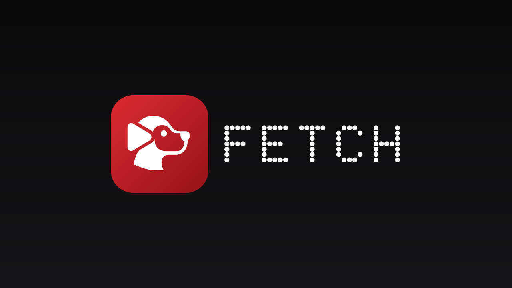
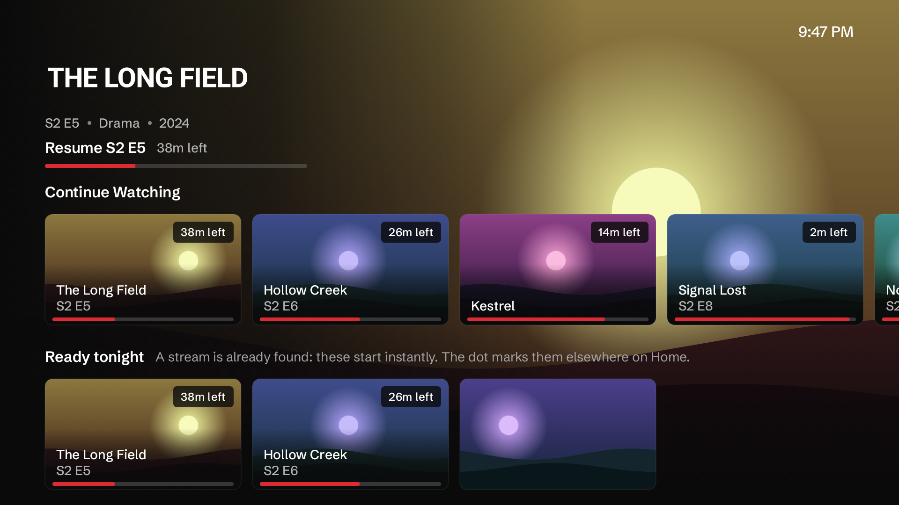
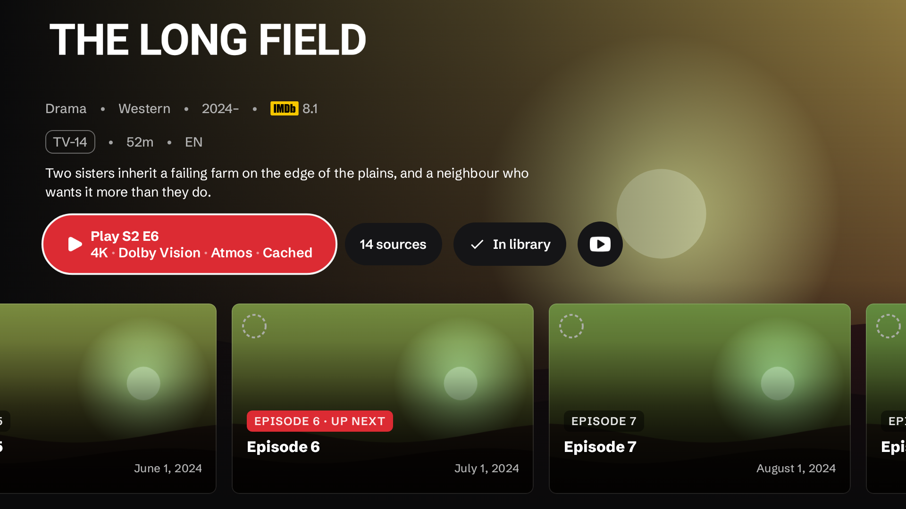
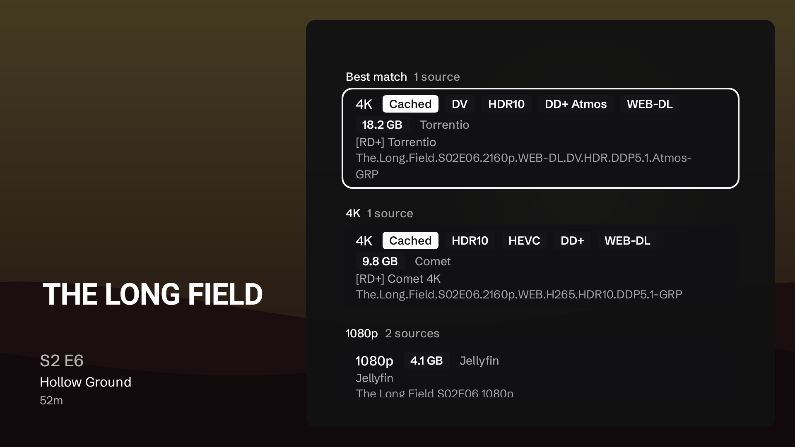
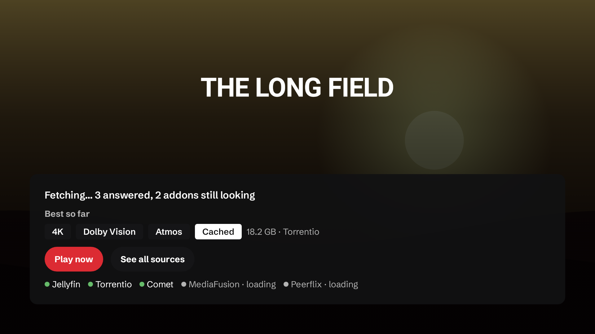
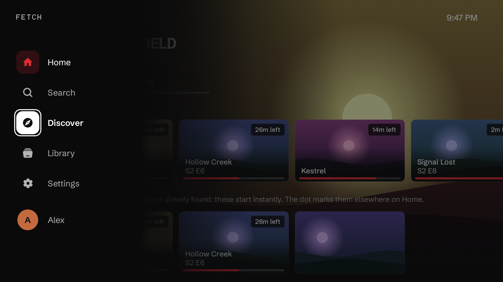
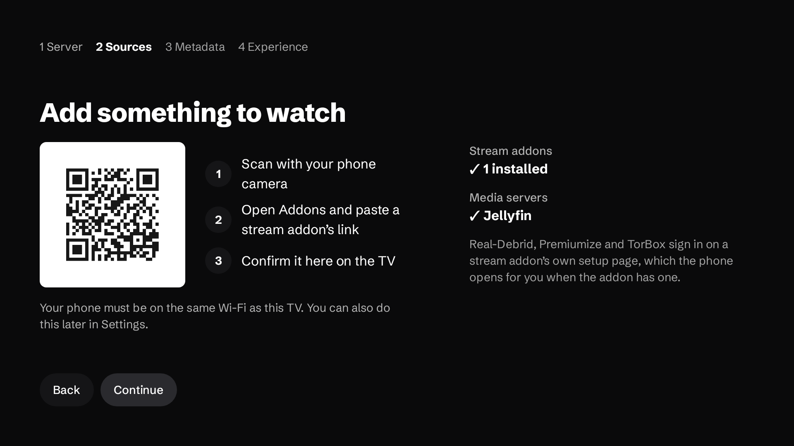

<div align="center">

  

  <p>
    A Stremio-addon media player for Android TV, built for a remote and for low-end hardware.
    <br />
    Bring your own addons and media server. No telemetry, no required account.
  </p>

</div>

## Screenshots

<p align="center">
  
  
</p>
<p align="center">
  
  
</p>
<p align="center">
  
  
</p>

Rendered from the app's own Compose screens with made-up sample titles and artwork
(`app/src/test/java/com/fetch/tv/screenshots/`). To regenerate them:

```bash
FETCH_SCREENSHOTS=1 ./gradlew :app:testDebugUnitTest --tests '*ReadmeScreenshots*'
```

## What it is

Fetch is an Android TV client for the Stremio addon ecosystem. Existing addons work unchanged:
manifest, catalog, meta, stream and subtitles resources, including `behaviorHints`
(`notWebReady`, `bingeGroup`, `proxyHeaders`, `filename`, `videoSize`, …).

Highlights:

- **Best-match playback.** Addon results are parsed into resolution, codec, HDR / Dolby Vision
  profile, audio format, size, source and cache state, ranked against your rules and what the
  TV can actually decode, and the winner starts immediately. Every other source is one press
  away, sorted best first.
- **A serious player.** Media3/ExoPlayer with the FFmpeg audio extension and libass for ASS/SSA,
  an mpv engine as a fallback, AC3/E-AC3/TrueHD/DTS passthrough, automatic refresh-rate
  matching, HDR10/HLG/Dolby Vision handling with base-layer fallback, subtitle timing/style/size
  controls, a sleep timer, and a one-press hand-off to an external player (mpv, Just Player, …).
- **Built for a remote.** Compose for TV, focus that returns to the row and item you came from,
  long-press context actions, and every flow works with D-pad, OK and Back. Your addons' movies
  and shows also turn up in the TV's own search (unless a profile has parental limits or the
  current one has a PIN), and "search for … in Fetch" opens Fetch's search.
- **Watch state.** Continue Watching, next-episode autoplay, skip intro/recap from community
  markers (IntroDB, AniSkip, Anime-Skip), Trakt and Simkl sync, AniList and MyAnimeList progress updates for anime,
  and the Android TV "Watch Next" row.
  The watch progress source you pick (Fetch Sync, Trakt, Simkl, MDBList or the Fetch website) is
  the one source of truth for Continue Watching and watched marks; you can import history from the
  others, from AniList or MyAnimeList, or from a Stremio account, into it once from Settings → Tracking.
- **Debrid through addons.** Like Stremio, debrid accounts are set up in the addons that support them.
  Fetch is debrid-only: it has no torrent engine and hides torrent results that have no playable link.
- **Your own library.** Jellyfin, Emby and Plex items appear alongside addon results and outrank them.
- **Configure from your phone.** Scan a QR code to manage addons, catalogs, stream ranking and
  badges from a phone browser on the same network, and to back up the whole TV to one file and
  restore it after a reset or on a new TV.
- **Local-first.** Everything lives on the TV. Sync is optional and only talks to a server you run
  (signing the TV in to it uses a code from `watchfetch.tv`, so you never type its address;
  see [PRIVACY.md](PRIVACY.md)).

See [docs/ROADMAP.md](docs/ROADMAP.md) for the full requirements list and what is done.

## The Fetch website

[`web/`](web/) is Fetch's optional self-hosted server and web app, formerly
[Cataloggy](https://github.com/TheShield2594/cataloggy). Run it with Docker Compose
and manage profiles, lists, watch history and settings from a phone or computer.
A paired TV syncs its profiles, library, watch progress, watched marks, addons, Home rows and
playback settings with it, and the website's lists reach the TV through its Stremio addon.
Anime and TMDB-only titles sync too, under their TMDB or anime-catalog id. Kids rules travel
with the profile, but the day's screen time is counted on each TV. [docs/ECOSYSTEM.md](docs/ECOSYSTEM.md) has what syncs and
[web/README.md](web/README.md) has setup.

## Supported devices and installing

Fetch runs on Android TV and Google TV devices (Android 7.0 or later) and on Fire TV devices
that run Fire OS. Fire TV sticks that run **Vega OS** (the 2025 Fire TV Stick 4K Select and
later Vega models) can't run Android apps, so they can't run Fetch. Phones and tablets aren't
supported: the APK declares Android TV (leanback) as required.

GitHub releases are the only place Fetch is published. Download `fetch-<version>-universal.apk`
(or the one for your TV's ABI, usually `arm64-v8a` or `armeabi-v7a`) and install it with a
downloader app on the TV, or from a computer with ADB:

```bash
# On the TV: Settings → Device Preferences → About → press Build 7 times, then
# Developer options → USB/Network debugging on. On Fire TV: My Fire TV → Developer options → ADB debugging.
adb connect <tv-ip-address>
adb install -r fetch-<version>-universal.apk     # -r keeps your data when updating
```

After that, Fetch updates itself from this repo's releases (Settings → About). Google is adding
developer verification for apps installed from outside the Play Store from 2026 onward; ADB
installs are expected to keep working, and this section will be updated if that changes.

On Fire TV, the Android TV launcher features (the Watch Next row, the Fetch channel on the home
screen and Fetch results in the system search) use Android TV provider APIs that the Fire OS
launcher isn't known to show. Inside Fetch everything works the same.

## Build

```bash
git clone https://github.com/TheShield2594/fetch.git
cd fetch
./gradlew :app:assembleDebug
```

Requires a JDK (17+) and the Android SDK (compile SDK 36). No keys are needed to build;
`local.example.properties` lists optional ones (TMDB, Trakt, Simkl, MDBList client IDs,
release signing).

### Trakt, Simkl, MDBList and other API keys

Sync and ratings integrations need app credentials that each service issues to the app's
developer. Without them the build works but the integration says its credentials are missing.

| Key | Where to get it |
| --- | --- |
| `TRAKT_CLIENT_ID`, `TRAKT_REDIRECT_URI` | [trakt.tv/oauth/applications](https://trakt.tv/oauth/applications). Trakt only accepts https redirect URIs; any https page works, e.g. this repo's URL. Fetch signs in with a device code and never opens it, but `TRAKT_REDIRECT_URI` must match the registered value or token refresh fails. New apps get no client secret; `TRAKT_CLIENT_SECRET` is only for older apps that have one |
| `SIMKL_CLIENT_ID` | [simkl.com/settings/developer](https://simkl.com/settings/developer/), app type "TV, devices & command line" (PIN sign-in, no secret or redirect URL) |
| `ANILIST_CLIENT_ID` | [anilist.co/settings/developer](https://anilist.co/settings/developer), with redirect URL `https://anilist.co/api/v2/oauth/pin` (AniList then shows the sign-in token to paste into the phone page; no client secret is used) |
| `MAL_CLIENT_ID`, `MAL_REDIRECT_URI` | [myanimelist.net/apiconfig](https://myanimelist.net/apiconfig), app type "other" (no secret). Its App Redirect URL must equal `MAL_REDIRECT_URI`, which defaults to `https://theshield2594.github.io/fetch/mal-callback.html`: the page in `site/` that the Pages workflow publishes once Pages is on (Settings → Pages → Source: GitHub Actions). A fork sets its own Pages address here |
| `MDBLIST_CLIENT_ID` | an OAuth app registered with MDBList |
| `TMDB_API_KEY` | [themoviedb.org/settings/api](https://www.themoviedb.org/settings/api) |

Put them in `local.properties` for local builds, or export them as environment variables
(these take precedence). The Release workflow reads repository secrets with the same names
(Settings → Secrets and variables → Actions) and warns in its log for each one that is unset.

There is one build: in-app updates from this repo's GitHub releases, in-app trailers and every
other feature are always on.

### Linux desktop

[`desktop/`](desktop/) is a personal desktop tool for the owner and friends, Linux first, not a
version of the TV app kept feature for feature, and it never gates a TV release. It shares the
addon protocol, stream parsing and ranking with the TV app through [`shared/`](shared/), and
plays in [mpv](https://mpv.io). It builds without the Android SDK:

```bash
./gradlew -Pfetch.desktopOnly=true :desktop:run
```

The Desktop workflow builds `.deb`, `.rpm`, Arch Linux (`.pkg.tar.zst`) and portable packages. See
[desktop/README.md](desktop/README.md) and [docs/desktop.md](docs/desktop.md).

### Optional native pieces

- **DV7 → 8.1 conversion** links a prebuilt [libdovi](https://github.com/quietvoid/dovi_tool)
  when `DOVI_NATIVE_ENABLED=true`. The static archives are not committed; build or download
  them into `DV7/libdovi/<abi>/` and point `DOVI_LIBDOVI_PREBUILT_ROOT` at that folder.
  **Release builds do not include it.** The release workflow does not set
  `DOVI_NATIVE_ENABLED`, so the APKs on the Releases page play Dolby Vision Profile 7 as its
  HDR10 base layer, including when Settings › Playback › Dolby Vision Handling is set to
  Convert to DV8.1 (the setting says so). Only a build you make yourself with libdovi converts.

### Logo

The mark is a dog in profile whose ear is a play button. The glyph lives in
`scripts/brand/mark_glyph.png` as an alpha mask; every launcher icon (all six palettes), TV
banner, splash mark and the image at the top of this README is generated from it:

```bash
python3 scripts/brand/generate_brand.py
```

## Privacy

No analytics, no automatic crash reporting, no account. Diagnostic reports exist only in builds
that configure their own report server, and only after you turn them on. See [PRIVACY.md](PRIVACY.md).

## Credits and license

Fetch is a fork of [NuvioTV](https://github.com/NuvioMedia/NuvioTV) by the Nuvio contributors,
whose work makes up most of this app. Like upstream it is licensed under the
[GNU General Public License v3.0](./LICENSE). That covers the website in `web/` too.

Media3, mpv, FFmpeg, libass, Coil, OkHttp and the other bundled libraries are credited, with
their licences, in Settings → About → Licenses & attributions. When you add or remove a
dependency, update `LicensesAttributionsScreen.kt` to match.
