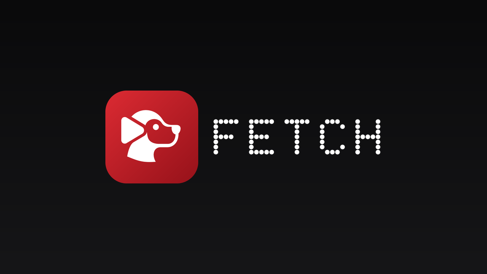
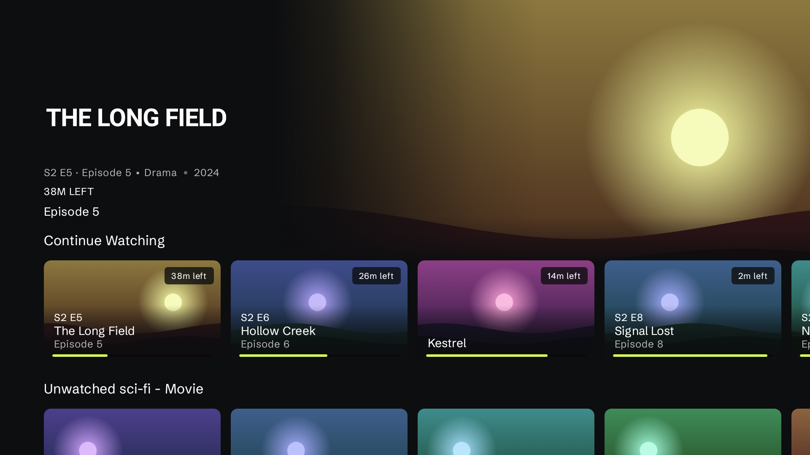
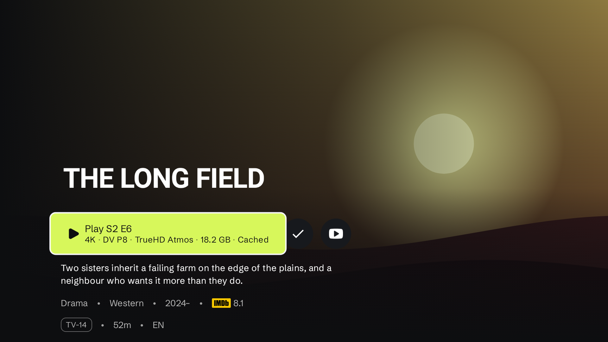
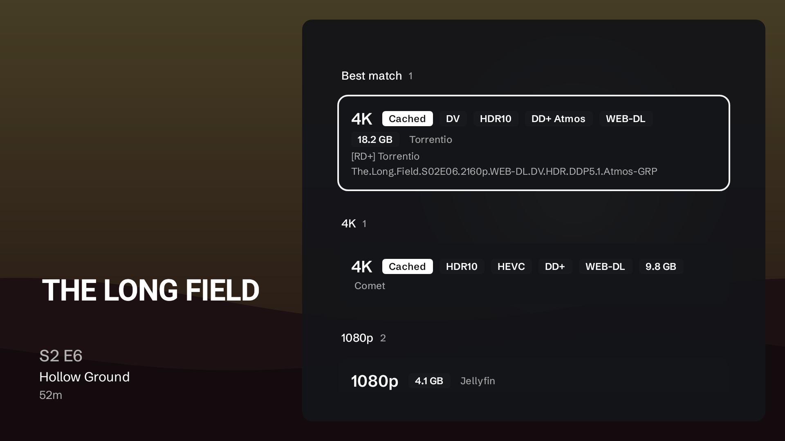
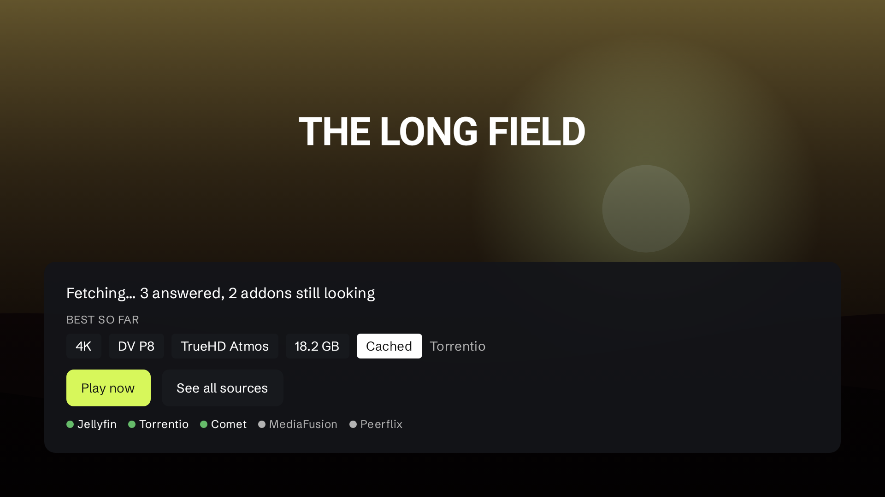
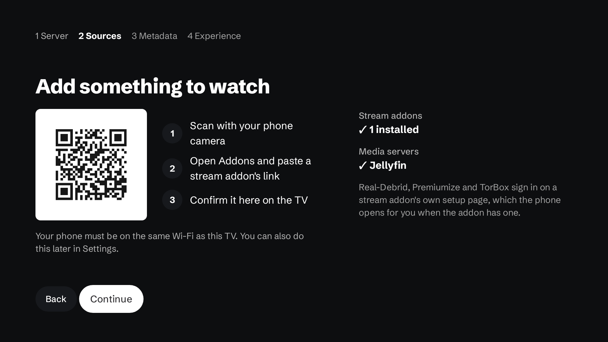

<div align="center">

  

  <p>
    A Stremio-addon media player for Android TV, built for a remote and for low-end hardware.
    <br />
    Bring your own addons, debrid service and media server. No telemetry, no required account.
  </p>

</div>

## Screenshots

<p align="center">
  
  
</p>
<p align="center">
  
  
</p>
<p align="center">
  
</p>

Rendered from the app's own Compose screens with made-up sample titles and artwork
(`app/src/test/java/com/fetch/tv/screenshots/`). To regenerate them:

```bash
FETCH_SCREENSHOTS=1 ./gradlew :app:testFullDebugUnitTest --tests '*ReadmeScreenshots*'
```

## What it is

Fetch is an Android TV client for the Stremio addon ecosystem. Existing addons work unchanged:
manifest, catalog, meta, stream and subtitles resources, including `behaviorHints`
(`notWebReady`, `bingeGroup`, `proxyHeaders`, `filename`, `videoSize`, …).

Highlights:

- **Best-match playback.** Addon results are parsed into resolution, codec, HDR / Dolby Vision
  profile, audio format, size, source and cache state, ranked against your rules and what the
  TV can actually decode, and the winner starts immediately. Every other source is one press
  away, sorted best first.
- **A serious player.** Media3/ExoPlayer with the FFmpeg audio extension and libass for ASS/SSA,
  an mpv engine as a fallback, AC3/E-AC3/TrueHD/DTS passthrough, automatic refresh-rate
  matching, HDR10/HLG/Dolby Vision handling with base-layer fallback, subtitle timing/style/size
  controls and a one-press hand-off to an external player (mpv, Just Player, …).
- **Built for a remote.** Compose for TV, focus that returns to the row and item you came from,
  long-press context actions, and every flow works with D-pad, OK and Back.
- **Watch state.** Continue Watching, next-episode autoplay, skip intro/recap from community
  markers (IntroDB, AniSkip, Anime-Skip), Trakt and Simkl sync, and the Android TV "Watch Next" row.
- **Debrid built in.** Real-Debrid, Premiumize and TorBox are app settings, not per-addon config.
- **Your own library.** Jellyfin and Emby items appear alongside addon results and outrank them.
- **Configure from your phone.** Scan a QR code to manage addons, catalogs, debrid formatting and
  badges from a phone browser on the same network.
- **Local-first.** Everything lives on the TV. Sync is optional and only talks to a server you run.

See [docs/ROADMAP.md](docs/ROADMAP.md) for the full requirements list and what is done.

## Build

```bash
git clone https://github.com/TheShield2594/fetch.git
cd fetch
./gradlew :app:assembleFullDebug
```

Requires a JDK (17+) and the Android SDK (compile SDK 36). No keys are needed to build;
`local.example.properties` lists optional ones (TMDB, Trakt, Simkl, MDBList client IDs, a
default self-hosted sync server, release signing).

### Trakt, Simkl, MDBList and other API keys

Sync and ratings integrations need app credentials that each service issues to the app's
developer. Without them the build works but the integration says its credentials are missing.

| Key | Where to get it |
| --- | --- |
| `TRAKT_CLIENT_ID`, `TRAKT_REDIRECT_URI` | [trakt.tv/oauth/applications](https://trakt.tv/oauth/applications). Trakt only accepts https redirect URIs; any https page works, e.g. this repo's URL. Fetch signs in with a device code and never opens it, but `TRAKT_REDIRECT_URI` must match the registered value or token refresh fails. New apps get no client secret; `TRAKT_CLIENT_SECRET` is only for older apps that have one |
| `SIMKL_CLIENT_ID` | [simkl.com/settings/developer](https://simkl.com/settings/developer/), app type "TV, devices & command line" (PIN sign-in, no secret or redirect URL) |
| `MDBLIST_CLIENT_ID` | an OAuth app registered with MDBList |
| `TMDB_API_KEY` | [themoviedb.org/settings/api](https://www.themoviedb.org/settings/api) |
| `PREMIUMIZE_CLIENT_ID` | Premiumize developer support |

Put them in `local.properties` for local builds, or export them as environment variables
(these take precedence). The Release workflow reads repository secrets with the same names
(Settings → Secrets and variables → Actions) and warns in its log for each one that is unset.

Two flavors exist: `full` (plugins, in-app updates from this repo's GitHub releases) and
`playstore` (store-safe feature set).

### Optional native pieces

- **DV7 → 8.1 conversion** links a prebuilt [libdovi](https://github.com/quietvoid/dovi_tool)
  when `DOVI_NATIVE_ENABLED=true`. The static archives are not committed; build or download
  them into `DV7/libdovi/<abi>/` and point `DOVI_LIBDOVI_PREBUILT_ROOT` at that folder.
- **On-device torrent streaming** is not included. Torrent results are resolved through your
  debrid service or handed to an external player.

### Logo

The mark is a dog in profile whose ear is a play button. The glyph lives in
`scripts/brand/mark_glyph.png` as an alpha mask; every launcher icon (all six palettes), TV
banner, splash mark and the image at the top of this README is generated from it:

```bash
python3 scripts/brand/generate_brand.py
```

## Privacy

No analytics, no crash reporting, no account. See [PRIVACY.md](PRIVACY.md).

## Credits and license

Fetch is a fork of [NuvioTV](https://github.com/NuvioMedia/NuvioTV) by the Nuvio contributors,
whose work makes up most of this app. Like upstream it is licensed under the
[GNU General Public License v3.0](./LICENSE).

Media3, mpv, libass, Coil, Haze and the other dependencies are credited in
Settings → About → Licenses & attributions.
