# Fetch: product, UX, engineering and competitive audit

Audit date: 9 November 2026. Audited commit: `e4d59e8` (`main`, app version 1.6.0).
Scope: the Android TV app (`app/`), with the desktop preview (`desktop/`) and the website (`web/`) assessed as part of the product strategy.

This is an audit. No application code, behaviour, styling or architecture was changed. The only files added are this report and the design concepts under `docs/audit/concepts/`.

## How to read this report

Every finding carries one of these labels.

| Label | Meaning |
|---|---|
| **Verified** | Read in the source at the cited file and line. |
| **Inferred** | A conclusion drawn from code that was read, not observed at runtime. |
| **Hypothesis** | Plausible, needs a device or a measurement to confirm. |
| **Standard** | A documented platform guideline, with a source link. |
| **Convention** | Common industry practice, with examples. |
| **Recommendation** | My judgment. |

Paths are relative to `app/src/main/java/com/fetch/tv/` unless they start with `app/`, `shared/`, `desktop/`, `web/`, `docs/` or `.github/`. All layout arithmetic assumes the standard 960×540 dp TV canvas, which is also what the repo's own screenshot test uses.

### Owner decisions recorded after the audit

The first version of this report ended with four questions. The owner answered them the same day, and the recommendations below have been updated to match.

| Question | Answer | Effect on the report |
|---|---|---|
| Is the Supabase backend or watch party in use? | No, and it will not be. The TV app is the product; the website is for the watchlist, history and settings. | E2 is a plain removal with no deprecation period. The website's scope is narrowed to exactly those three things. |
| Is the YouTube section used? | Yes. | It stays. E3 changes from "remove" to "contain": one shared parser, out of the critical paths, failures isolated. |
| Are app-store releases planned? | No. GitHub releases only. | The `playstore` flavour has no purpose and is recommended for removal (new item E6). Store-review risk drops out. |
| Who is the desktop app for? | The owner and a few friends. | It stays as a personal tool. It is not a product surface: no parity target, no polish budget, shared code instead of copies. |

### What was and was not possible

- **Static analysis: done in depth.** Six parallel audits read the shell and navigation, every browse and management screen, the detail → sources → player pipeline, the design system, the data and startup layers, and the desktop and website.
- **Screenshots: rendered from the app's own Compose screens.** `docs/screenshots/*.png` are drawn by `app/src/test/java/com/fetch/tv/screenshots/ReadmeScreenshots.kt` (Robolectric, 960×540 dp at 2×). I installed the Android SDK, built the app at the audited commit and ran that harness here. I also ran it once with a temporary, uncommitted copy that removes the detail page's −190 dp scroll offset, to capture the detail page as a user first sees it (`docs/audit/detail-first-screen.png`). The harness draws only the handful of composables that take plain data; screens bound to a view model (search, library, settings, the player overlay) cannot be rendered this way, which is itself a finding about testability.
- **No device, no emulator, no profiling.** Nothing in this report is a runtime measurement. `docs/performance.md` has every results table empty, so the project has no measurements either. Performance findings are classified by how sure the mechanism is, never by a number.
- **Research: primary sources for platform standards; press and community reports for competitors.** Gaps are listed in section 3.6.

---

## 1. Executive summary

### What Fetch is

Fetch is a remote-first Android TV client for the Stremio addon ecosystem and for Jellyfin, Emby and Plex. It is a fork of NuvioTV with three ideas of its own: it picks the best stream for the user's actual TV and tells them what it picked before they press Play; it is local-first with an optional server the user runs; and it has household controls (kids rules, screen time) that no competitor in this niche has.

### The verdict in five sentences

1. **The core idea is excellent and already built.** "Press OK and the best version your setup can play starts, and here is what it is" is a better promise than Stremio, Plex or Kodi make, and Best match, the spec line, "Ready tonight" and the Fetching panel deliver it.
2. **The product around that idea is not yet at the same level.** Navigation hides most of the app, the detail page spends a whole screen on a hero, search buries the best result, and the player's weakest part is the thing people do most (seeking).
3. **Nothing has been proven on hardware.** There are no startup, frame or memory measurements, the baseline profile is inherited from the upstream fork, and the first public release is still an open issue.
4. **The surface area is far beyond what one person can validate.** The TV app is about 257k lines; the repo also holds a 56k-line desktop app, a 61k-line website, three sync backends, two build flavours, a YouTube client and a watch party.
5. **The right move is to cut, verify and sharpen, not to add.** Fetch needs fewer things, each finished and measured, arranged around its one distinctive promise.

### The twelve findings that matter most

| # | Finding | Label | Where |
|---|---|---|---|
| 1 | No device measurements exist, and `startup-prof.txt` is byte-identical to `baseline-prof.txt` (98,862 lines each), which the project's own docs describe as the broken state. | Verified | `docs/performance.md`, `app/src/main/generated/baselineProfiles/` |
| 2 | Back on Search, Library or Settings opens the sidebar, and a second Back exits the app with no prompt by default. Back never returns to Home. | Verified | `MainActivity.kt:1575-1583` |
| 3 | The sidebar's four default items hide about twenty destinations. Stats and Calendar are two buttons in the Library header; Home customisation lives inside the addon manager, which lives inside "Content & discovery". | Verified | `MainActivity.kt:1143-1201`, `ui/screens/library/LibraryScreen.kt:668-673`, `ui/navigation/FetchNavHost.kt:1335-1337` |
| 4 | The detail page's hero is a fixed 540 dp, the full height of the screen. Episodes and sources are below the fold on every series. | Verified | `ui/screens/detail/HeroSection.kt:198` |
| 5 | With several half-watched episodes, Play can resume the oldest one: `maxWithOrNull` is applied to a descending comparator. | Verified by reading (I re-read it myself); not executed | `ui/screens/detail/NextToWatchProgress.kt:10-16` |
| 6 | An error after playback has started is a dead end: no Retry, no next source, and expired links (401/410) are never retried. | Verified | `ui/screens/player/PlayerScreen.kt:4179-4335`, `PlayerRuntimeControllerSourceFailover.kt:32`, `PlayerRuntimeControllerErrorRecovery.kt:39-76` |
| 7 | Seek feedback shows a bare bar and "position / duration" for 1.5 s: no target time at the playhead, no delta, no chapters, no skip markers. | Verified | `ui/screens/player/PlayerScreen.kt:3692-3737` |
| 8 | Next-episode auto-play is off by default, and without skip markers the next-episode card appears at 99% of the runtime. | Verified | `data/local/PlayerSettingsDataStore.kt:317`, `ui/screens/player/PlayerNextEpisodeRules.kt:36-125` |
| 9 | Search results are one row per addon catalog, with duplicates and no merged top result. Home has no "See all": the callback is wired and then dropped. | Verified | `ui/screens/search/SearchScreen.kt`, `ui/screens/home/HomeScreen.kt:85` |
| 10 | DataStore Preferences is the database. Every write rewrites the whole file and copies it again to a `.bak`; the local library is Gson-decoded on the main thread on every detail-page open. | Verified | `data/local/ProfileDataStoreFactory.kt:250-270`, `data/local/LibraryPreferences.kt:54-59`, `ui/screens/detail/MetaDetailsViewModel.kt:474-493` |
| 11 | A persisted 15-minute job and a boot receiver cold-start the whole process in the background, up to 96 times a day. | Verified (mechanism); cost unmeasured | `core/sync/androidtv/TvChannelRefreshJobService.kt:23, 82-95` |
| 12 | `PRIVACY.md` says Fetch only contacts services the user adds, but the parental guide is on by default and sends IMDb ids to a hard-coded third-party host. | Verified | `core/di/NetworkModule.kt:325`, `data/local/PlayerSettingsDataStore.kt:292` |

### What I recommend, in one paragraph

Adopt one product thesis, **"Fetch knows what will play"**, and make every screen express it. Then run seven initiatives: **(A) Prove it** on real devices and ship a first release; **(B) Fix the core loop** (the resume bug, mid-playback recovery, seek feedback, binge defaults); **(C) Restructure navigation** into five destinations with a correct Back model; **(D) Redesign the four screens people live in** (Home density, a detail page with episodes above the fold, merged search, a tabbed Library); **(E) Subtract**: remove the Supabase backend, watch party, the `playstore` flavour and the fork leftovers, contain the YouTube client, and stop chasing desktop parity; **(F) Build a component layer** on top of the existing tokens; and **(G) Shore up the foundations** (main-thread JSON, background wake-ups, persistence, profile state). Section 16 has the full roadmap and section 17 the order, which is not alphabetical: eight small verified fixes come first.

---

## 2. Product understanding and current state

### 2.1 Purpose, audience and use cases

| | |
|---|---|
| **Purpose** | Play anything the user's addons and media servers can provide, at the best quality their TV can show, with the least possible deciding. |
| **Primary audience** | A technically comfortable home-theatre user who already has debrid-backed Stremio addons, often a Jellyfin or Plex server, cares about Dolby Vision, passthrough audio and refresh-rate matching, and distrusts hosted accounts. (Inferred from the feature set and docs.) |
| **Secondary audience** | That person's household: partners and children who just want to press Play, and a parent who wants limits. |
| **Primary use cases** | Resume what I was watching. Play the next episode. Find a film for tonight. Let a child use the TV safely. Set everything up from a phone. |
| **Platforms** | Android TV, Google TV and Android-based Fire TV (minSdk 24, targetSdk 36; four ABIs). Two flavours: `full` (sideload, in-app updates, trailers, YouTube) and `playstore` (store-safe). A Linux desktop preview and a self-hosted website exist alongside. |

### 2.2 Technology

| Layer | What is used | Evidence |
|---|---|---|
| UI | Jetpack Compose for TV (`tv-material 1.1.0-rc01`), Navigation-Compose 2.8.8, Compose BOM 2026.05.01, Kotlin 2.3 | `gradle/libs.versions.toml` |
| DI | Hilt 2.58, 265 `@Singleton` classes | performance audit |
| Network | Retrofit 2.9 / OkHttp 4.12 / Moshi; Ktor and Supabase for the opt-in backend | `gradle/libs.versions.toml` |
| Persistence | DataStore Preferences only: about 40 stores per profile plus 8 device-wide. No Room or SQLite. | `data/local/` |
| Images | Coil 3.3, RAM-scaled memory cache, storage-scaled disk cache, sized requests | `FetchApplication.kt:73-166` |
| Playback | Media3 1.8.0 ExoPlayer, FFmpeg audio, libass, mpv fallback engine | `ui/screens/player/` (126 files, 54.5k lines) |
| Local servers | NanoHTTPD for the phone hub and addon configuration, LAN only with pairing tokens | `core/server/` |
| Tests | 2,592 unit tests in 387 files; 45 instrumented tests that CI never runs | `app/src/test`, `.github/workflows/ci.yml` |

### 2.3 Size, and what it implies

| Surface | Code | Note |
|---|---|---|
| TV app | 919 files, about 257k lines | Player 54.5k, settings 22k, home 15k, detail 15k |
| Shared | 7.8k lines | Addon protocol, stream parsing and ranking |
| Desktop | 55.9k lines | Went from nothing to this in eight days of the visible history |
| Website | about 61k lines of TypeScript, 146 API routes, 12 pages | Formerly a standalone tracker (Cataloggy) |

Forty-eight files exceed 1,000 lines. The five largest are `PlayerScreen.kt` (4,587), `MetaDetailsScreen.kt` (3,792), `ProfileSelectionScreen.kt` (3,591), `HomeViewModelContinueWatching.kt` (3,382) and `AddonWebPage.kt` (3,341, HTML and JavaScript inside a Kotlin string).

**Observation.** Code is being produced much faster than it can be exercised on devices. The recent commit history is almost entirely bug roll-ups and race fixes, which is what that looks like from the outside.

### 2.4 Navigation and screen hierarchy (Verified)

Start-up is a chain of gates inside one `setContent`, not navigation destinations (`MainActivity.kt:756-900`): blank until auth and PIN state load → account QR on first launch → profile picker (when more than one profile, or a PIN applies) → blank until layout preferences load → first-run wizard or addon setup → Home. A splash overlays all of it until Home reports content.

```text
Sidebar (default)        Hidden behind something else
────────────────         ───────────────────────────────────────────────────────────
Home                     Discover            icon beside the search field
Search                   Stats, Calendar     two buttons in the Library header
Library                  Collections, Filter rows, Catalog order
Settings                                     cards inside the addon manager
(profile avatar)         Addon manager       Settings › Content & discovery
                         Watch party         Settings, only on the Supabase backend
                         YouTube             sidebar, only when signed in to YouTube
                         Person / studio     from detail pages and search
```

The full route inventory, with entry points and completeness, is in section 7.

### 2.5 What is implemented, partial, planned and missing

| State | Items |
|---|---|
| **Implemented and strong** | Stream parsing and device-aware Best match with visible reasons; the Fetching panel; "Ready tonight"; one-press resume from Home; phone hub (remote, keyboard, sign-ins, rules, backup); kids rules, PINs, screen time and bedtime; Android TV system search with parental awareness; subtitle auto-sync; AFR, HDR and Dolby Vision policy; skip intro/recap/credits; Trakt and Simkl sync; website pairing and sync. |
| **Implemented, with a weak experience** | Navigation and Back; detail page layout; search results; Discover; Library chrome; seek feedback; player error recovery; settings depth; Home customisation discoverability. |
| **Implemented but dormant or off-mission** | Supabase backend and watch party (release builds resolve the server to `https://sync.invalid`); membership and supporter stubs; playback-report repositories with no endpoint; a speed test that scrapes fast.com. |
| **Partial** | Low-end performance work (tooling exists, no numbers); DV profile 7 → 8.1 conversion (code exists, not in CI release builds); translations (several locales 40–70% complete); accessibility; live TV (addon channels play, no guide). |
| **Missing, and worth adding** | A watch-history view; new-episode surfacing on the TV; a merged search result; "See all" from Home; in-place recovery from a failed stream; chapters and skip markers on the scrubber. |
| **Missing, and rightly so** | Downloads, casting, picture-in-picture, a live-TV guide, music and photos, an on-device recommendation engine. |

### 2.6 Where the docs disagree with the code (Verified)

| Doc claim | Reality |
|---|---|
| `README.md`: website sync is "in progress" | Done; the TV calls about twenty website endpoints. |
| `docs/ECOSYSTEM.md`: the website uses one shared `API_TOKEN` | Replaced by accounts, invites and sessions. |
| `docs/cloudflare-migration-audit.md`: the TV calls no website endpoint | Stale. |
| `docs/essential-mode.md`: "Add-ons" is a root destination | No longer exists. |
| `docs/screenshots/sidebar.png` | Hand-built in the test with Search above Discover, the reverse of production order. |
| `docs/screenshots/home.png` | Rendered with `heroSectionEnabled = false`, and `detail.png` with a −190 dp offset so the Sources row is visible. Neither is what a user sees first. |
| `docs/performance.md`: targets include Fire OS 5 (API 22) | `minSdk` is 24, so those devices cannot install it. |
| `docs/ROADMAP.md`: parental controls done | The same file lists #169–#176 open. |
| `release_test_cases.csv` | The upstream mobile and iOS test plan ("Tap the screen"); 4 of 93 rows concern Android TV. |
| `PRIVACY.md`: only services you add or turn on | See finding 12 and section 13.5. |

---

## 3. Independent industry research

Platform standards below come from primary pages that were read in full. Competitor material comes partly from press coverage and community threads and is marked as such.

### 3.1 Android TV and Google TV quality bar

Google restructured TV app quality into three tiers in May 2026 ([TV app quality](https://developer.android.com/docs/quality-guidelines/tv-app-quality)). All of the following are **Standard**.

| Tier | Requirements that matter to Fetch | Fetch today |
|---|---|---|
| **3, required** | All functions reachable by D-pad; no reliance on a Menu key; Back leads to the Android TV home; video pauses when the user leaves; D-pad centre toggles pause; left/right seek; resume items follow the Watch Next rules; memory limits on low-RAM devices | Mostly met. Gaps: memory limits unmeasured; Watch Next publishes next-up episodes as `CONTINUE` (`core/recommendations/ProgramBuilder.kt:35`) |
| **2, optimised** | Baseline Profiles; voice search via the keyboard or a mic button; voice playback commands through `MediaSession` | Profile is stale; voice search exists; media-session voice commands not audited |
| **1, differentiated** | **Content frame-rate matching**; audio output switching; **enhanced accessibility** (audio description, subtitle styles, high-contrast UI, simplified navigation, playback speed); Engage SDK | AFR is built and is a genuine strength; accessibility is partial; Engage needs programme enrolment, so the classic Watch Next API is the realistic route |

### 3.2 Layout, focus and navigation (Standard)

Sources: [layouts](https://developer.android.com/design/ui/tv/guides/styles/layouts), [cards](https://developer.android.com/design/ui/tv/guides/components/cards), [focus system](https://developer.android.com/design/ui/tv/guides/styles/focus-system), [navigation](https://developer.android.com/training/tv/start/navigation), [navigation drawer](https://developer.android.com/design/ui/tv/guides/components/navigation-drawer).

- **Canvas:** 960×540 dp, 12 columns of 52 dp with 20 dp gutters.
- **Overscan:** a 5% margin. Google's page gives both 48/27 dp and 58/28 dp in different passages, and notes most modern TVs no longer overscan. Fire TV says keep UI out of the outer 5% ([Fire TV design guidelines](https://developer.amazon.com/docs/fire-tv/design-and-user-experience-guidelines.html)).
- **Card widths at 20 dp spacing:** 4-up is 196 dp, 5-up is 124 dp. Aspect ratios: 16:9, 1:1, 2:3.
- **Focus:** four indicators (scale, border, glow, colour), default scales 1.025 / 1.05 / 1.1, and "one uniform focus scheme across the app".
- **Back with left navigation:** from mid-page content, Back opens the side menu and focuses the active item. No exit confirmation dialogs. Deep links behave as if the user navigated there.
- **Navigation drawer:** 3–7 destinations, 5–6 advised; always icons.
- **Text:** Fire TV sets a 14 sp minimum for body text. Google's TV type scale is published only as images, so I quote no sp values for it.

### 3.3 Playback, Watch Next and memory (Standard)

- **Controls** ([playback controls](https://developer.android.com/training/tv/playback/controls)): centre is play/pause, left/right skip, hold to scrub, up/down peek info.
- **Frame rate** ([frame rate](https://developer.android.com/media/optimize/performance/frame-rate)): for long-form video Google strongly recommends `CHANGE_FRAME_RATE_ALWAYS`, with a user notice and a 2-second settle after `onDisplayChanged`.
- **Watch Next** ([guidelines](https://developer.android.com/training/tv/discovery/guidelines-app-developers)): a film is "started" after 3% or 2 minutes; an episode after 2 minutes. Content is "finished" when the credits start, or with under 3 minutes left as an approximation. On finishing an episode, add the next with `WATCH_NEXT_TYPE_NEXT`. One episode per series.
- **Memory** ([TV memory](https://developer.android.com/training/tv/playback/memory)): on 1 GB devices total memory must not exceed 280 MB. Media buffers should be 40–60 MB at 1 GB/1080p and 100–120 MB at 2 GB/4K. While seeking, buffer no more than 5 s ahead. Stop playback and release resources in `onStop`.
- **tvOS, for comparison** ([playing video](https://developer.apple.com/design/human-interface-guidelines/playing-video.md)): resume automatically, never ask; no loading screen under two seconds; on exit, land on the details page; supply a thumbnail track for scrubbing.

### 3.4 Conventions in 2026

| Area | Convention | Source and confidence |
|---|---|---|
| Navigation | Netflix, Disney+, Prime Video and Google TV moved to top navigation in 2025. Plex did the same, met sustained backlash (users reporting actions going "from two clicks to around six"), and is restoring the left panel. | [Netflix help](https://help.netflix.com/en/node/321880164349028); [Android Authority on Plex](https://androidauthority.com/plex-brings-back-left-side-menu-3700033); [PiunikaWeb](https://piunikaweb.com/2026/05/04/plex-fire-tv-redesign-unusable-users-slam-navigation/). Press and community. |
| Home density | Netflix's 2025 home replaced the preview area with an expanding card and shows fewer titles; complaints about density and autoplay continued for months. | [Android Authority](https://www.androidauthority.com/netflix-new-tv-experience-redesign-3555283); [TechRadar](https://techradar.com/streaming/the-new-ui-is-borderline-unusable-netflix-subscribers-are-still-complaining-about-the-app-re-design-and-im-100-percent-with-them). Press. |
| Card badges | Cards carry decision information ("#1 in TV Shows", awards). | [Netflix Tudum](https://www.netflix.com/tudum/articles/netflix-new-tv-layout) |
| Player | Apple puts Info, Episodes and Chapters in tabs under the transport controls, so episodes change without leaving playback. | [Apple HIG](https://developer.apple.com/design/human-interface-guidelines/playing-video.md) |
| Still watching | Netflix prompts after 3 episodes and 90 minutes; Jellyfin's Android TV client has an optional, configurable prompt. | [Netflix help](https://help.netflix.com/en/node/114059); [Jellyfin 0.19](https://jellyfin.org/posts/androidtv-v0.19.0/) |
| Search | Autocomplete, recent searches, titles and years beside artwork; a long list cost 245 right-arrow presses in NN/g's study. | [NN/g](https://www.nngroup.com/articles/smart-tv-usability/) |
| Skip intro and credits | Expected even in self-hosted clients. Stremio moved it into a paid tier in June 2026. | [Plex](https://support.plex.tv/articles/credits-detection/); [Stremio review](https://www.firesticktvstream.com/stremio-review/) (secondary) |

### 3.5 Accessibility standards

WCAG 2.2 is a web standard, applied to TV by analogy ([WCAG 2.2](https://www.w3.org/TR/WCAG22/)): text contrast 4.5:1; focus indicators and UI components 3:1; focus visible and not obscured; auto-starting motion over five seconds needs a way to stop it (this bears on autoplay trailers); timing adjustable (this bears on countdowns and auto-hiding controls). Android's TV guide asks apps to respect the system font scale and the audio-description preference ([TV accessibility](https://developer.android.com/training/tv/accessibility)). Ofcom-commissioned research with viewers over 65 found cluttered home screens and inconsistent menus were the main barriers, and a simplified screen cut them by almost half ([DTG](https://dtg.org.uk/2025/09/18/simple-design-changes-cut-streaming-tv-usability-barriers-in-half-for-older-viewers)).

### 3.6 Research gaps

- Google's TV type scale and drawer widths are published as images; no values are quoted.
- No authoritative source was found for next-episode countdown lengths or for TV motion timings.
- BBC GEL TV guidance and Netflix TechBlog TV-performance posts were not found.
- Max and YouTube were researched lightly. Omni, Weyd, Emby's current client and Debrid Media Manager's TV story were not verified.
- The Plex reversal rests on summaries of press coverage; the primary article returned 403.
- Whether Google's 2026–27 sideloading verification applies to Android TV is unverified.

---

## 4. Competitive benchmarking

| Product | Does exceptionally well | Struggles with | What Fetch should take |
|---|---|---|---|
| **Netflix** | A personal hub, Top 10, skip and still-watching polish, recommendations that react while browsing | The 2025 redesign cut density and control | The binge loop defaults. Not the density loss. |
| **Apple TV app** | Focus and parallax, cross-app Up Next, content tabs inside the player, silent resume | New look limited to newer hardware | Player tabs; exit to the details page; restraint. |
| **Plex** | Credits detection, server ecosystem | 2025–26 redesign: more clicks, lag, removed controls; reversing its navigation | The lesson: library apps need a left rail and user-ordered sources. |
| **Jellyfin (Android TV)** | Free and open, HDR capability detection, media segments | Official client seen as sluggish; basic search | Server segments as a skip-marker source. |
| **Stremio** | The addon ecosystem and account sync | Empty on first install; DV/HDR colour faults and stutter reported by users; extras now paywalled | Its ecosystem, minus its player and its paywall. |
| **Infuse** | Format and HDR breadth, metadata quality, a version picker | Apple-only, subscription | The feeling of "it just plays, correctly". |
| **Kodi** | Maximum flexibility, chapters, configurable seek steps | Setup effort, slow on weak hardware | Chapters and seek steps. Not the settings sprawl. |
| **NuvioTV** | The same stack as Fetch; free synced profiles; layout control | Young; hosted account | Nothing to copy: it is Fetch's upstream. Fetch must be clearly different from it. |

Detail and sources for each row are in section 3.4 and in the research notes cited there. Community complaints are anecdotal.

### Where Fetch already beats all of them (Recommendation, grounded in the code)

1. **It names the file before you press Play**, and explains what it skipped and why. Nobody else does this.
2. **It knows the display.** Ranking refuses Dolby Vision profiles the TV cannot show and audio the receiver cannot decode.
3. **It shows what is ready now.** "Ready tonight" turns a watchlist into a list of things that will start instantly.
4. **It is honest while waiting.** The Fetching panel shows which addons answered and the best result so far.
5. **It has real household controls**, working offline, merging tighten-only across TVs.
6. **It can be set up from a phone** without an account.

### Platform risks to plan around

- **Fire TV:** new sticks run Vega OS, which runs no Android apps and allows no sideloading. The sideloadable Fire TV base will shrink. (Press reporting: [AFTVnews](https://www.aftvnews.com/tag/vega-os/page/2/).)
- **Sideloading:** Google's developer verification for sideloaded apps begins enforcement in four countries on 30 September 2026 and expands in 2027. ([Android Authority](https://www.androidauthority.com/android-sideloading-changes-timeline-3679204/).)
- **Stores:** not a concern. The owner distributes through GitHub releases only, which also means the sideloading change above is the distribution risk that matters.

---

## 5. Product vision and design direction

### 5.1 The thesis: Fetch knows what will play

Every other client in this niche shows a list of files and makes the user choose. Subscription apps have nothing to choose. Fetch sits between: it has many sources and **takes responsibility for the choice**, then shows its work.

That is the product. Everything in the app should either serve it or get out of its way.

> **Fetch finds the best version your setup can play, tells you what it is, and starts it.**

The name already says this. A dog that fetches does not ask which stick.

### 5.2 Four principles

| Principle | What it means in practice | What it rules out |
|---|---|---|
| **1. One press to picture** | From any card that can play, OK starts playback or resumes it. Detail pages are for deciding, not a toll gate. | Mandatory detail pages, confirmation prompts, source lists by default. |
| **2. Show the work, in one line** | A single spec line ("● Ready · 4K · Dolby Vision · Atmos") appears wherever a play action does: hero, Play button, search result, player. Reasons for skipped files stay one press away. | Raw filenames as the primary label; hidden ranking; engineer-facing errors. |
| **3. Quiet, then cinematic** | Near-monochrome chrome, with the artwork as the only colour. Red means exactly three things: the play action, progress, and where you are. | Decorative colour, competing accents, glass effects, autoplay trailers by default. |
| **4. Fast on a stick** | Every design choice is checked against a 1.5 GB device. Density beats spectacle. Motion is short and never moves layout. | Expanding cards that relayout rows, blur, parallax, per-frame recomposition. |

### 5.3 What makes Fetch recognisable

| Signature | Status | Recommendation |
|---|---|---|
| **The Fetch line** (spec strip) | Exists as `SpecStrip`, used on the hero, the Play button and the player | Make it the product's visual signature. One component, one typographic treatment, everywhere a play action exists. |
| **The ready dot** | Exists on "Ready tonight" cards, unexplained | Give it one meaning ("starts instantly at your best quality") and use it consistently: cards, search results, library filter. |
| **The fetch moment** (Fetching panel) | Exists and is good | Keep. It is the one place where waiting is turned into trust. |
| **The dotted wordmark** (Doto) | Exists in the sidebar only | Keep it rare: sidebar, splash, ambient clock. It reads as a readout, which suits a product about specs. |
| **White focus, red action** | Exists | Enforce it. Focus is always white; red is never a focus colour. |

### 5.4 Where to be conventional, and where not

| Be conventional | Innovate |
|---|---|
| Left rail with five destinations | The spec line on every play action |
| Back goes up one level, then Home, then the rail, then out | "Ready tonight" and a "Ready to play" filter in the Library |
| Centre is play/pause; left/right seek | A sources screen that explains itself ("why this one", "why not that one") |
| Continue Watching first on Home | Recovery that re-resolves an expired link in place |
| Season tabs and an episode row | A household mode that is the best in the category |
| Silent resume | Honest waiting (the Fetching panel) |

### 5.5 How it should feel

**Calm, exact, immediate.** The opposite of both a subscription app's merchandising and a power-user app's control panel. A person who has never heard of debrid should be able to sit down, press OK on the first card, and get the best picture the TV can show. A person who cares about Dolby Vision profiles should be able to see, in one line, that they got it.

### 5.6 What this direction changes

| Today | Direction |
|---|---|
| Four sidebar items hiding twenty destinations | Five destinations; everything else folded into them |
| A full-screen hero on the detail page | A 250 dp hero with episodes on the first screen |
| One search row per addon | One merged, de-duplicated result set with a top result |
| A Library that shows one provider at a time under four rows of controls | One Library with tabs: Watchlist, In progress, History, Upcoming, Lists, Servers, Stats |
| Seek feedback as a bare bar | Target time and delta at the playhead; chapters and skip segments on the bar |
| An error screen that sends you away | Retry and next source, in place, at the saved position |
| 24 settings categories in Advanced | Essential by default; Advanced as a clearly separate layer |
| Three surfaces and three backends | TV plus an optional account server |

The design concepts in section 15.3 show each of these.

---

## 6. Complete UI/UX audit

This section is the cross-screen view. Section 7 goes screen by screen.

### 6.1 Visual design

| Aspect | Assessment | Evidence |
|---|---|---|
| **Identity** | The stated direction (near-monochrome, one red, white focus, a dot-matrix wordmark) is coherent and good. It is present in the sidebar, the ambient clock and the Play button, and absent from the screens people spend time on. Home and detail read as a competent, generic dark streaming UI. | `docs/screenshots/home.png`, `detail.png`, `ambient-clock.png` |
| **Typography** | Schibsted Grotesk is a good choice and nothing in the scale is under 12 sp. But six of fifteen styles are 14 sp, and 518 of 832 typography references use them. Hierarchy is carried by grey levels more than by size. | `ui/theme/Type.kt`; design audit counts |
| **Colour and contrast** | All text/surface pairs pass 4.5:1 in every theme, checked by a test. White on Fetch red is 4.73:1. Two failures: red used as text is 3.85:1 ("BEST MATCH"), and the white focus ring vanishes against light accent fills (1.0:1 in the White theme). | `ui/screens/detail/DetailSourcesRow.kt:81`; computed from `ui/theme/ThemeColors.kt` |
| **Spacing and layout** | A spacing scale exists (0–56 dp) but 1,154 raw `.dp` literals remain, and the five most common (10, 6, 14, 20, 18 dp) are off the scale. Screen edge padding is 32, 36, 48, 52 or 56 dp depending on the screen. | Section 14 |
| **Density** | Low where it should be high. Home shows about four landscape cards and one row plus a peek. Library shows roughly one row of posters under four rows of controls. Detail shows no episodes at all on entry. | Section 7 |
| **Artwork** | Requests are sized to the display and cached well. Scrims over artwork are hand-built per screen (the scrim tokens have zero uses), so title legibility over bright art is decided screen by screen. | `ui/theme/Color.kt`; `ui/components/Skeletons.kt:180-212` |
| **Surfaces and layering** | Ten surface roles collapse to four values, and card versus background is 1.09:1. Depth is nearly invisible; the resting border that compensates is applied on two screens only. | Design audit contrast table |
| **Consistency** | Spec chips are outlined on the detail page and filled on the sources screen for the same data. Buttons are pills, 12 dp or 8 dp. There are twelve focus scale factors. | `detail.png` vs `sources.png`; section 14 |
| **Premium feel** | Close. The restraint is right. What undercuts it is inconsistency in small things and the amount of screen given to empty hero. | — |

**Dated or weak, specifically:** Material 3 dropdowns and an outlined text field inside a TV interface (Search, Library, Discover); the all-caps heavy fallback title, which contradicts the "medium-weight title card" intent written in `Type.kt:76-77`; a first-run background visibly bluer than Home; filenames that wrap mid-token on the sources screen ("…Atmos-GR / P").

### 6.2 Navigation and information architecture

| Question | Answer |
|---|---|
| Is the structure discoverable? | **No.** Four sidebar items; about twenty destinations. Calendar, Stats, Discover, Collections, Filter rows and Catalog order are each behind something unrelated. |
| Is Back predictable? | **No.** On a root screen, Back opens the sidebar and a second Back exits. From the Settings rail that is two presses to leave the app, with no prompt by default (`MainActivity.kt:1575-1583`). Empty-state buttons in Library, Stats and Calendar push Search or Settings without `popUpTo`, so Back cannot return (`FetchNavHost.kt:1220-1244`). |
| Is the sidebar visible? | Icons sit 9–13 dp from the left edge, inside the 5% overscan zone. Rail buttons are focusable only while expanded. |
| Is focus restored? | **Yes on Home**, by item key, surviving list refreshes. Elsewhere it depends on fixed delays. |
| Are there dead ends? | Possible: closing the sidebar with Right consumes the key and never hands focus back to the page (`MainActivity.kt:1641-1645`). Home re-claims focus; Search, Library and Settings may not. **Hypothesis**, needs a device. Discover requests no initial focus (`ui/screens/search/SearchDiscoverSection.kt`). |
| Is it intuitive without explanation? | The resume path is. Long-press is the only route to library, watched and pin actions, with no on-screen hint. |

### 6.3 Workflows

Press counts are derived from the focus wiring, from Home's initial focus with default settings.

| Workflow | Presses | Friction | Verdict |
|---|---|---|---|
| Open Fetch → resume | 1 (2 with the profile picker) | None. The hero names the action and the file. | **Excellent** |
| Open → play something new from Home | 4 + N | A detail page is mandatory; no "See all" from a row, so item 60 is 60 presses. | Adequate |
| Discover something new | 5 to reach Discover, then 3–4 per filter | Hidden behind an unlabelled compass icon. One catalog at a time. | **Weak** |
| Search by voice → play | 6 + speech | Focus jumps to the first result, which is good. Results are per-addon rows with duplicates. | Adequate |
| Open a series → play next episode | 1 | None. | **Excellent** |
| Open a series → play a specific episode | Down ×3, Left/Right ×n, OK | Hero fills the screen; the Sources row is an extra stop before seasons. | Weak |
| Switch season | Down ×2, Left/Right | Focus selects, no OK needed. | Good |
| Add to library from a card | Long-press, Down, OK | No success feedback; only failures toast (`ui/components/posteroptions/PosterOptionsController.kt:199-216`). | Weak |
| Find something watched last month | Not possible | No history view. Stats shows aggregates only. | **Missing** |
| Change subtitle language during playback | About 7 (1 + 3 with a Captions key) | Three rails. Deep but well laid out. | Adequate |
| Change a common setting | About 15 to reach Subtitles in Advanced | Settings search helps but needs typing. | Weak |
| Recover from a failed stream | Exit, pick another source, wait | No Retry, no next source after the first frame. | **Poor** |
| Return to browsing after playback | 1 | Lands on detail with the next episode focused, or on the sources list after a manual pick. | Good |
| Switch profile | 7+ | Re-runs the whole start-up path including the splash. | Weak |

---

## 7. Screen-by-screen findings

### 7.1 Route inventory (Verified)

| Route | Purpose | How it is reached | State |
|---|---|---|---|
| `home` | Hero that follows focus, plus rows | Start; sidebar | Complete |
| `search` | Text and voice search, recent searches | Sidebar; empty-state buttons; system search | Complete |
| `discover` | Type / catalog / genre grid | Icon in the search row (default) or sidebar (setting) | Complete, thin |
| `library` | Saved lists and media-server shelves | Sidebar | Complete, chrome-heavy |
| `stats`, `calendar` | Statistics; upcoming episodes | One button each in the Library header | Complete, buried |
| `youtube` | A full YouTube client | Sidebar when signed in | Complete; kept by owner decision |
| `settings` | Two-pane settings | Sidebar | Complete, very deep |
| `catalog_see_all` | Grid for one catalog | Search rows of 15+; Library server shelves | Partial: the Home path has no caller |
| `folder_detail` | A collection folder | Collection cards on Home | Complete |
| `collections`, `collection_editor`, `filter_rows`, `filter_row_editor`, `catalog_order` | Build and order Home rows | Addon manager only | Complete, buried |
| `addon_manager` | Install addons, health | Settings › Content & discovery | Complete |
| `cast_detail`, `tmdb_entity_browse` | Person and studio browse | Detail page; search | Complete, in good shape |
| `watch_party` | Synced viewing | Settings, Supabase backend only | Dormant |
| `trakt` | Standalone tracking settings | One empty-state button | Duplicate of a settings page |
| `detail`, `stream`, `player` | Title → sources → playback | Cards | Complete |
| Ambient mode | Clock or artwork screensaver | Idle timeout | Complete, clean |

### 7.2 Home

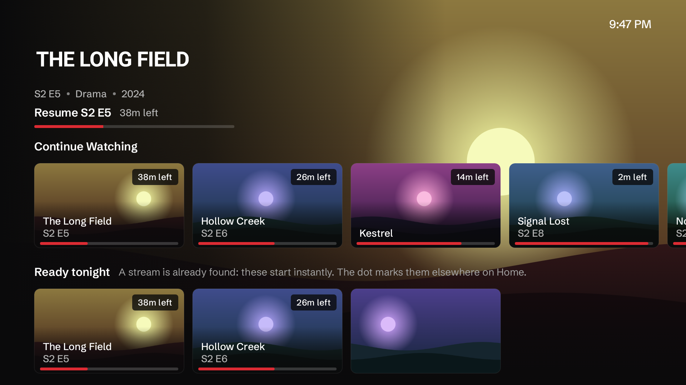

*Current Home, from the repo's renderer. Note it is rendered with the hero section disabled.*

**What is good (Verified).** OK on a Continue Watching card resumes in one press, and the hero says exactly what will happen ("Resume S2 E5 · 38m left"). The spec line is read from a per-profile cache, so moving focus queries no addon. Initial focus is deterministic. Hero updates are debounced 200 ms. Held Up/Down becomes a constant-velocity scroll.

**Problems.**

| # | Problem | Label | Evidence |
|---|---|---|---|
| H1 | No "See all". `onNavigateToCatalogSeeAll` is wired in the nav host and dropped at `HomeScreen.kt:85`. | Verified | `ui/navigation/FetchNavHost.kt:258` |
| H2 | About four landscape cards (209×118 dp) and one row plus a peek. The rows viewport is 49% of the screen. | Inferred from constants | `ui/screens/home/ModernHomeContent.kt:1064`, `:697-718` |
| H3 | Row start padding is a literal 52 dp in three places, not the 48 dp token. In the screenshot the title sits at a different left edge from the metadata under it. | Verified | `ModernHomeContent.kt:726`, `ModernHomeRows.kt:566,673` |
| H4 | Long-press is the only path to library, watched and pin, with no hint. | Verified | `ModernHomeRows.kt:1368` |
| H5 | "Ready tonight" appears only with two or more ready titles and the green dot is never explained. | Verified | `ui/screens/home/ReadyTonight.kt` |
| H6 | No offline state: a network failure shows whatever string the view model produced. | Verified | `ui/screens/home/HomeScreen.kt:239-292` |
| H7 | New episodes of followed shows are not surfaced, though the calendar computes them. | Verified | `ui/screens/calendar/CalendarViewModel.kt` |
| H8 | `ModernHomeContent` is one 1,200-line composable passing about 70 parameters down. It works and is the riskiest browse file to change. | Verified | `ModernHomeContent.kt:1263-1345` |

### 7.3 Detail

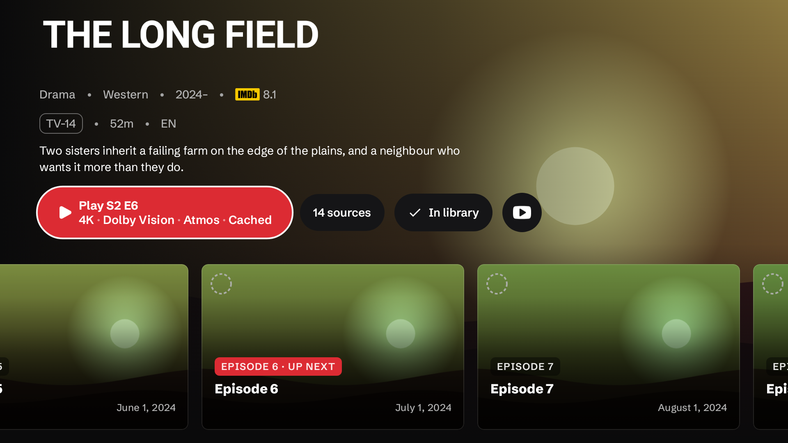

*The README's detail screenshot. The test scrolls the page by −190 dp to show the Sources row.*

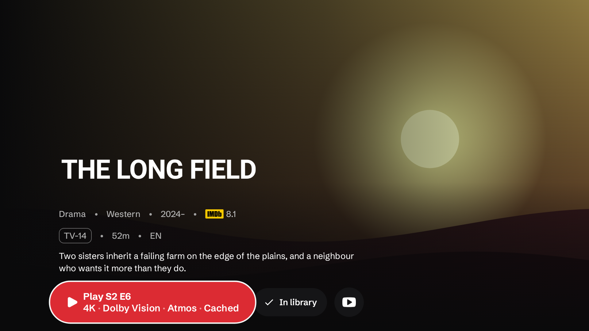

*The same screen rendered for this audit with the offset removed: what a user sees on entry. No season tabs, no episodes, no sources. The upper half is empty artwork. The focused Play button's 1.1× scale also pushes it over the neighbouring "In library" button and to about 12 dp from the bottom edge, inside the overscan margin.*

| # | Problem | Label | Evidence |
|---|---|---|---|
| D1 | The hero is a fixed 540 dp, the whole screen. Nothing shows that episodes exist until the user presses Down. | Verified in code and by rendering | `ui/screens/detail/HeroSection.kt:198` |
| D2 | The Sources row's Best match card calls the same handler as Play and shows the same pick. It adds a focus stop before seasons on every series. | Verified | `ui/screens/detail/MetaDetailsScreen.kt:2697` |
| D3 | When resuming, the hero swaps the synopsis and ratings for a full episode row of the season, and the real episode row sits below. The same season appears twice. | Verified | `MetaDetailsScreen.kt:1346-1353` |
| D4 | **Bug:** `maxWithOrNull(compareByDescending { lastWatched }…)` returns the oldest resumable entry. It bites when two or more episodes are half-watched and the latest entry is not resumable. Existing tests have at most one resumable entry. | Verified by reading | `ui/screens/detail/NextToWatchProgress.kt:10-16` |
| D5 | Opening a title queries every stream addon after a 900 ms dwell, on by default. Each addon learns what the user looked at, not only what they played. Rate-limit cost on debrid-backed addons is likely. | Verified; cost inferred | `core/streams/BestMatchPreviewer.kt:150-156` |
| D6 | When a remembered binge group or a reused link will decide instead of Best match, the Play button's spec line goes blank with no explanation. | Verified | `core/player/StreamAutoPlaySelector.kt:203-216` |
| D7 | Cast, Ratings, More like this, Trailer and Collection share one tab strip that switches on focus. A user scrolling down sees only the active tab. | Verified | `MetaDetailsScreen.kt:2824-2849` |
| D8 | Start from beginning, choose a file, list picker, season and episode actions are all long-press only. | Verified | `ui/screens/detail/EpisodeOptionsOverlay.kt:195-258` |
| D9 | The spoiler setting blurs thumbnails of unwatched episodes but leaves titles and overviews readable. | Verified | `ui/screens/detail/EpisodesSection.kt:679` |
| D10 | `MetaDetailsContent` is one composable of about 2,100 lines with roughly 110 parameters. | Verified | `MetaDetailsScreen.kt:1218-3330` |

**What is good.** Play is one press. The label is exact ("Resume S2 E5", "Next S2 E6"). Seasons switch on focus. Focus returns to the right episode after playback, and advances the season when the finished episode was the last.

### 7.4 Sources and the Fetching panel

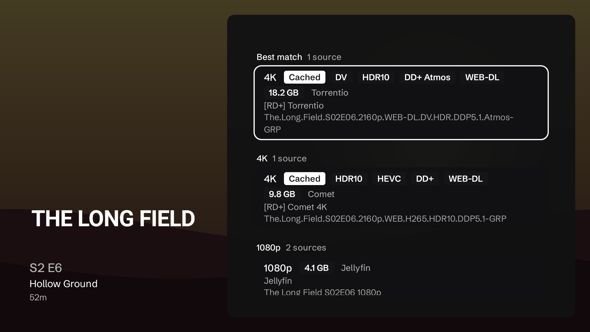
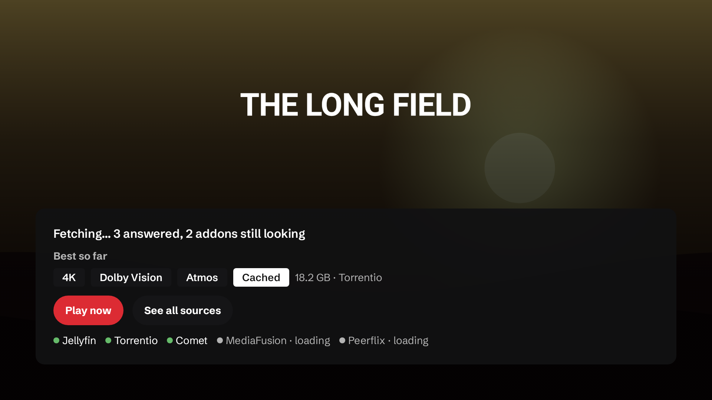

**This is the best part of the product.** The pick is named before Play, a skipped better-looking file gets a one-line reason, excluded streams stay visible under "Passed over", and a long-press builds a rule from a stream. The Fetching panel shows honest progress and offers a usable result early, with a careful rule that an OK aimed at "See all sources" can never start playback (`ui/screens/stream/FetchingPanel.kt:78-88`).

| # | Problem | Label | Evidence |
|---|---|---|---|
| S1 | The score is never shown, so "why is this 1080p above that 4K" among eligible streams has no answer on screen. | Verified | `shared/.../ranking/StreamRanker.kt:300-415` |
| S2 | A cold Play can wait up to 10 s on one slow addon unless the user presses Play now. "Start without waiting" is off by default. | Verified | `core/player/StreamAutoPlaySelector.kt:35-42` |
| S3 | Filenames wrap mid-token. | Verified | `sources.png` |
| S4 | The same chips are outlined on detail and filled here. | Verified | `detail.png` vs `sources.png` |

### 7.5 Search and Discover

| # | Problem | Label | Evidence |
|---|---|---|---|
| Q1 | Results are one horizontal row per addon search catalog. The same title appears once per addon. There is no merged or ranked top result and no type filter. | Verified | `ui/screens/search/SearchScreen.kt`, `SearchViewModel.kt` |
| Q2 | Input is the system IME through a non-TV Material 3 `OutlinedTextField`. Whether the IME shows the suggestions Fetch pushes to it depends on the device. | Verified; device behaviour is a hypothesis | `SearchScreen.kt:526-533` |
| Q3 | Search ignores the user's card-width preference. | Verified | `SearchScreen.kt:324-331` |
| Q4 | Discover is three dropdowns over a single addon catalog: no sort, year or rating. Paging is a manual "Load more" card. It is a catalog picker, not discovery. | Verified | `ui/screens/search/SearchDiscoverSection.kt:741-763` |
| Q5 | Discover requests no initial focus, and focusing a dropdown entry needs a retry loop (3 frames, then 6 × 32 ms, then a 48 ms re-assert). | Verified | `SearchDiscoverSection.kt:325-343` |

**What is good.** Live results with a 350 ms debounce that stay on screen while typing; voice search with a level ring; eight recent searches; focus moves to the first result on submit; a people row; clear empty and error states.

### 7.6 Library

- One grid whose first full-span items are a title row, a view-mode row (with Stats and Calendar buttons), a selectors row of up to six dropdowns, and an actions row. Posters start under three to four rows of controls (`ui/screens/library/LibraryScreen.kt`). **Verified.**
- It shows exactly one source at a time: local, Trakt, Simkl, MDBList or Fetch website. A user with Trakt lists and local lists cannot see both. **Verified** (`shared/.../domain/model/LibraryModels.kt`).
- Nine different things can be called "my library" or "my lists" (section 13.2). "Collections" means three different things.
- No history tab.

### 7.7 Settings

- 280 dp category rail plus a detail pane. **Advanced mode has up to 24 rail entries under six headings; Essential has 13–14** (`ui/screens/settings/SettingsCatalog.kt`). About 285 rows in total; `PlayerSettingsDataStore.kt` alone defines 123 preference keys.
- Worst-case depth is five levels: sidebar → Settings → rail entry → sub-section → row → picker.
- Addons, the most important setup task, are under "Sources › Content & discovery", a label that does not say "addons".
- Edge padding is 32/24 dp, short of the safe area on the right and both verticals.
- **Good:** settings search with a "changed only" filter that opens the page focused on the row; the rail follows focus after 140 ms; Essential mode trims pages instead of forking screens.
- **Risk:** rail and pane focus is a hand-built retry state machine with attempt counters and 200 ms / 1 s windows (`SettingsScreen.kt:266-457`). Its comments record several regressions.

### 7.8 Profiles and first run

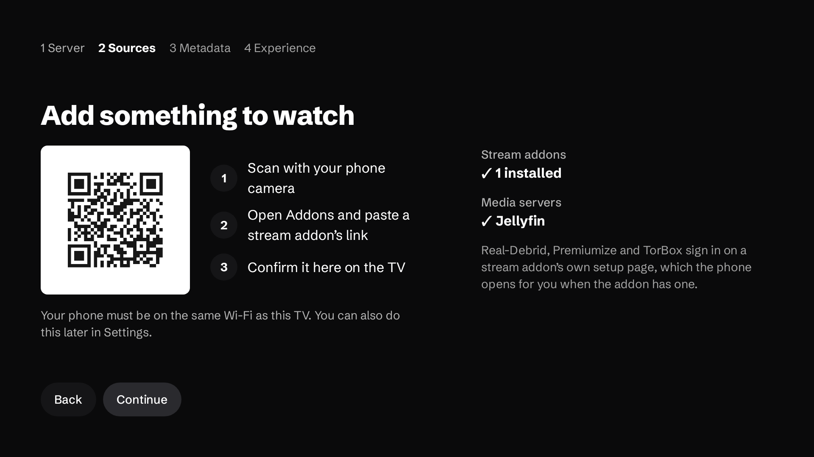

- The first-run wizard is clear and built around one phone QR code. This is the right answer to typing on a TV.
- A fresh install passes two QR screens (account, then wizard) before Home.
- "Remember last profile" is off by default, so a multi-profile household sees the picker on every cold start.
- `ProfileSelectionScreen.kt` is 3,591 lines holding the picker, editors, PIN entry and pickers.

### 7.9 Sidebar

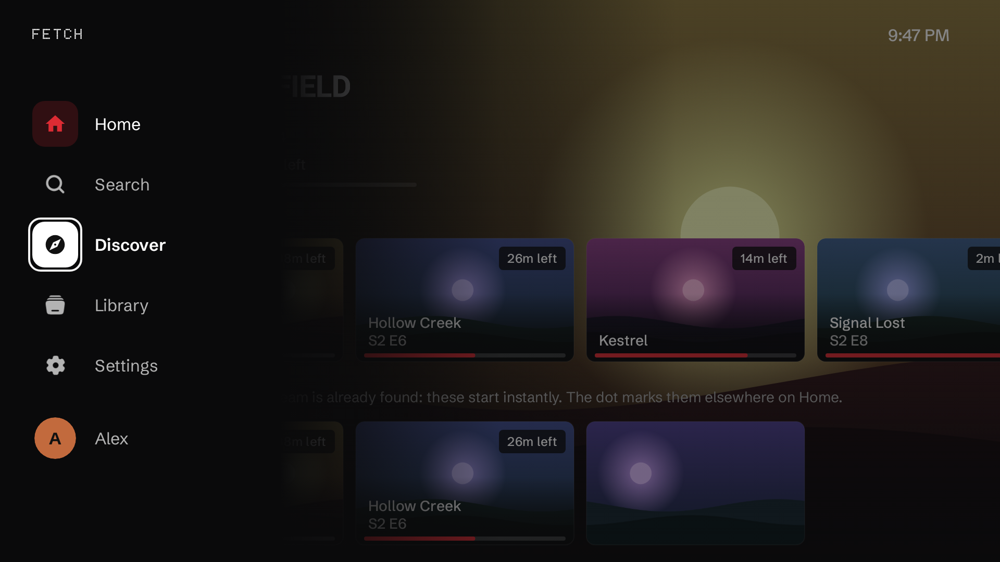

- Restrained and on-brand. The selected item is a red icon on a red-tinted tile; the focused item is a white tile with a ring.
- Icons sit 9–13 dp from the edge. The rail is 72 dp closed and 300 dp open; a second token says 262 dp (`ui/theme/SizeTokens.kt:107` vs `ComponentTokens.kt:133`).
- The screenshot is hand-built and shows an item order that production does not use.

### 7.10 Screens that are fine

Person and studio browse, Calendar, Stats, See-all, ambient mode and the phone hub are coherent, have loading, empty and error states, and need no redesign. Calendar and Stats need a better home, not a better screen.

---

## 8. Workflow and navigation findings

### 8.1 The Back model

| Where | Back does today | Should do |
|---|---|---|
| Home, focus mid-row | Scrolls the row to its first item | Keep |
| Home, at rest | Opens the sidebar | Keep (matches Google's left-navigation rule) |
| Sidebar open | Exits, no prompt by default | Keep on Home only |
| **Search, Library, Settings at rest** | **Opens the sidebar; next Back exits** | **Return to Home** |
| Search results | Row start → text field → sidebar | Row start → text field → Home |
| Library, scrolled | Top of grid, focus on selectors | Keep |
| Discover grid, any depth | Jumps to the Type filter | Scroll to top, then Home |
| Settings detail pane | Back to the rail | Keep |
| Screens pushed from an empty state | Treated as a root: sidebar, then exit | Pop back to the caller |
| Player, controls hidden | Exits playback | Keep (matches Netflix and Apple TV); see P3 note in section 16 |

Google's guidance is that Back from content opens the side menu and focuses the active item, and that apps should not gate exit. Fetch follows that literally on every root screen, which produces the two-press exit from Settings. The fix that keeps the standard and removes the trap is: **Back on a non-Home root goes to Home; Back on Home opens the rail; Back on the rail exits.**

### 8.2 Hidden features

| Feature | Where it lives | Where a user would look |
|---|---|---|
| Customise Home rows | Settings › Content & discovery › Addons › Catalog order | Home, or Settings › Home |
| Collections, Filter rows | Same place | Same |
| Calendar | A button in the Library header | Home or the rail |
| Stats, year in review | A button in the Library header | Profile or Library tab |
| Discover | A compass icon left of the search field | The rail |
| Start from beginning, pick a file | Long-press Play | The action row |
| Mark watched, add to list | Long-press a card | A visible hint |
| Backup and restore | Phone hub `/backup` | Settings › System, and first run on a new TV |
| Kids rules and screen time | Profile editor | The README does not mention them |

### 8.3 Feedback gaps

- Adding to the library or marking watched from the poster menu confirms nothing on success.
- When the spec line goes blank (binge group or reused link decides), nothing says why.
- Addons that time out are shown as errors on their chips and then removed after 1.6 s, taking the evidence with them (`ui/screens/stream/StreamScreenViewModel.kt:1204-1207`).

---

## 9. Television-specific UX findings

### 9.1 Safe area

| Surface | Horizontal | Vertical | Verdict |
|---|---|---|---|
| Sidebar icons and wordmark | 9–13 dp from the edge | wordmark top 24 dp | Inside the 5% zone |
| Home rows | 52 dp plus the 54 dp rail offset | rows run to the bottom by design | Fine |
| Home clock | 48 dp | 24 dp | 3 dp short |
| Search | 48 dp | 16 dp top | Top short |
| Library, Calendar, Stats | 48 dp | 24 dp top | 3 dp short |
| Settings | 32 dp | 24 dp | Right edge and both verticals short |
| Addon manager | 36 dp | 28 dp | Horizontal short |
| Profile picker, first run | 56 dp | 27 / 48 dp | Fine |

Tokens for the safe area exist (`spacing.screen` 48/27 and `overscan` 56/36) and are barely used: `screen.horizontal` 13 times, `screen.vertical` twice. Modern panels rarely overscan, so the practical harm is limited to older sets; the inconsistency is the real problem.

### 9.2 Focus

**Good patterns (Verified).** Key-based restore on Home; `focusRestorer` on rows and grids; frame-based waits in the shell; loading states that hold focus; dialogs opening on the safe choice; side panels in the player that trap focus and return it to the opening button.

**Risky patterns.**

| Pattern | Where | Risk |
|---|---|---|
| Focus requested after a fixed delay | `SearchScreen.kt:462,498`; `LibraryScreen.kt:216-261`; `SearchDiscoverSection.kt:331,339`; `SettingsScreen.kt:415`; `ModernHomeRows.kt:909`; detail's initial focus retried 3 × 80 ms; `PlayerScreen.kt:667` | On a slow stick a missed window leaves focus on the wrong element or nowhere. |
| Sidebar closed with Right, no hand-back | `MainActivity.kt:1641-1645` | Possible "nothing focused" on Search, Library, Settings. Hypothesis. |
| Index-keyed focus requesters in Home rows | `ModernHomeRows.kt:942-981` | Correct only while the relocation logic stays correct. |
| No initial focus | Discover | First key press does nothing visible. |

### 9.3 Key repeat

Three schemes: `dpadVerticalFastScroll` (Home, Discover), `dpadRepeatThrottle` at 80/112 ms (Search, See-all), and an inline drop-repeats throttle (Library). Settings, Calendar, Stats and the addon manager have none. Holding a direction feels different on every screen.

### 9.4 Focus appearance

Colour is consistent: every ring is near-white. Scale is not: twelve factors from 1.0 to 1.15, and 150 of 165 buttons use the tv-material default of 1.1, which is large for a control. Google asks for one uniform focus scheme. See section 14.4.

### 9.5 Long titles and metadata

Row titles and card labels are one line with an ellipsis; hero titles two lines; episode titles marquee on focus. This is handled. The exception is the sources list, where release names wrap mid-token.

### 9.6 Remote shortcuts

In the player: Play/Pause, Stop, Next, Previous, FF/Rewind, Captions and Info are handled; `MEDIA_SKIP_FORWARD/BACKWARD`, Menu and number keys are not. On browse screens there are no media-key shortcuts: Play/Pause on a focused card does nothing. Menu opens the poster menu, which helps only on remotes that have a Menu key.

### 9.7 Nested menus

Settings reaches five levels. The player's subtitle overlay is three rails. Everything else is shallow.

---

## 10. Playback experience audit

### 10.1 What the player does well (Verified)

- **Layout.** Lists on the left (Episodes, Queue, Next), transport in the centre, tuning on the right (Subtitles, Audio, Sources, Speed), rare items behind More. Title top-left with the spec line; clock and "Ends at" top-right, adjusted for speed.
- **Preview-then-commit seeking.** D-pad seeks move the timeline on each key-down and issue one real seek on key-up, which avoids a storm of network seeks on debrid links.
- **Recovery before the first frame.** Up to two automatic retries, codec and audio fallback ladders, Dolby Vision fallbacks, and automatic next source across up to five streams.
- **Completion guards.** Streams of two minutes or less never save progress, so debrid placeholder clips cannot mark episodes watched.
- **Depth without clutter.** Subtitle delay, style, auto-sync, audio delay, per-output memory, a stream info overlay, a sleep timer.
- **Tests.** About 55 policy tests pin back handling, next-episode rules, scrub rates, skip visibility and failover inputs.

### 10.2 Problems, ranked by user impact

| # | Problem | Label | Evidence |
|---|---|---|---|
| P1 | **Errors after playback started are a dead end.** The error screen offers only "Choose another source". The next-source path returns early once a frame has rendered, and 400/401/403/404/410 are never retried, so a debrid link that expires during a long pause is fatal. | Verified | `PlayerScreen.kt:4179-4335`; `PlayerRuntimeControllerSourceFailover.kt:32`; `PlayerRuntimeControllerErrorRecovery.kt:39-76` |
| P2 | **Seek feedback is the weakest piece and the most used.** With controls hidden: a bare bar and "position / duration" for 1.5 s. No target time at the playhead, no "+30 s", no direction. | Verified | `PlayerScreen.kt:3692-3737`; `PlayerRuntimeControllerTrackSelection.kt:36-42` |
| P3 | **Seek steps disagree.** D-pad is ±10 s ramping to 60 s; the on-screen buttons are −10 s / +30 s; neither is configurable. | Verified | `PlayerScrubRates.kt:12-33`; `PlayerScreen.kt:3174-3178` |
| P4 | **Binge defaults.** Next-episode auto-play is off. Without skip markers the next-episode card appears at 99%, about 30 seconds from the end of a 50-minute episode. | Verified | `PlayerSettingsDataStore.kt:317`; `PlayerNextEpisodeRules.kt:36-125` |
| P5 | **Error text is engineer-facing:** `HTTP 404 Not Found [ERROR_CODE_IO_BAD_HTTP_STATUS]`. | Verified | `PlayerRuntimeControllerErrorRecovery.kt:113-150` |
| P6 | **Watched is a flat 90%.** Stopping a three-hour film 18 minutes from the end marks it watched and drops the resume point. Google's own rule is "credits start, or under 3 minutes left". | Verified threshold; effect inferred | `shared/.../domain/model/WatchProgress.kt:46` |
| P7 | **No chapters and no skip-segment marks on the scrubber**, although skip segments are already loaded. | Verified | no "chapter" under `ui/screens/player` |
| P8 | **Cycle buttons.** Sleep timer cycles off → 15 → 30 → 45 → 60 → 90 → end; cancelling a 15-minute timer takes six presses. Aspect cycles seven modes. | Verified | `core/player/SleepTimer.kt:79-86`; `PlayerAspectScaleUtils.kt:12-20` |
| P9 | **Progress is saved every 90 s**, so a kill can lose up to 90 s. | Verified | `PlayerRuntimeControllerPlaybackEvents.kt:41` |
| P10 | **Watch Next publishes next-up episodes as `CONTINUE`** with position 0, instead of `NEXT`. | Verified | `core/recommendations/ProgramBuilder.kt:35` |
| P11 | **In-player panels use the wrong theme.** The episodes and sources panels import the non-TV `MaterialTheme`, so they render the platform font and 12 sp text. | Verified | `StreamSourcesSidePanel.kt:26`; `EpisodesSidePanel.kt:30` |
| P12 | **Overlay state is many booleans** with hand-copied condition lists that already disagree about the queue panel. | Verified | `PlayerRuntimeControllerPlaybackEvents.kt:1056-1167`; `PlayerScreen.kt:636-660, 909-917` |

### 10.3 Resume, exit and return

- Resume is automatic and silent between 2% and 90%. This matches Apple's guidance and is right. There is no small rewind before the saved point; several players rewind a few seconds, which helps after a long gap. **Recommendation**, low priority.
- One Back press with controls hidden exits. This matches Netflix and Apple TV. I do not recommend a confirmation; I do recommend that exit is always safe, meaning the position is saved at that moment (it is) and the return lands on the right card (it does).
- Back lands on the detail page with the next episode focused after a completed episode, and on the sources list with the picked stream focused after a manual pick. This is correct.

### 10.4 Hard-coded timings worth exposing or revisiting

| What | Value | Note |
|---|---|---|
| Controls auto-hide | 4 s | Not configurable; does not adapt to a screen reader |
| Seek overlay | 1.5 s | Too short to read a target time |
| Pause overlay appears | 5 s | Fine |
| Auto-play countdown | 3 s | Short; 5–10 s is kinder (no authoritative industry figure found) |
| First-frame timeout | 12 s | Fine |
| Stall watchdog | 15 s | Fine |
| Progress save interval | 90 s | Shorten to about 30 s once writes are cheap (section 12) |
| "Prefer next time" prompt | after 4 s, for 12 s | Fine |

### 10.5 Architecture risk in the player (Verified)

- `PlayerScreen` is one composable from line 217 to 2133, with 54 effect blocks, collecting the entire `PlayerUiState` (165 fields).
- `PlayerRuntimeController` is about 18,400 lines over 30 files of extension functions sharing roughly 347 mutable fields. The split helps navigation and encapsulates nothing.
- The stream URL, a JSON header map and the JSON sources list travel in the navigation route string (`ui/navigation/Screen.kt:72`). Tokenised debrid URLs and auth headers therefore sit in back-stack saved state, and after process death the restored route points at a link that may have expired.

Every fix in section 10.2 is riskier than it should be because of this. That is the argument for the refactoring items in the roadmap, not tidiness.

---

## 11. Accessibility audit

Overall: **above average for an Android TV app, with specific gaps.** Nothing here was tested with TalkBack on a device.

| Area | Status | Finding | Evidence |
|---|---|---|---|
| Text size | Good | Nothing in the scale under 12 sp; a test enforces it. One escape: the Continue Watching poster title scales to 11.9 sp. | `ui/components/ContinueWatchingSection.kt:84, 333` |
| Font scaling | Partial | Text is in sp and the system scale is honoured up to 1.3×. Fixed-height cards, 52 dp buttons and episode metrics with hard-coded line heights will likely clip at 1.3×. Hypothesis. No in-app text size option. | `MainActivity.kt:214, 644`; `EpisodesSection.kt:1206-1283` |
| Contrast | Good, two gaps | All text/surface pairs pass, tested across 14 themes. Red as text is 3.85:1 at 11 sites. Disabled text is 2.2:1. | `DetailSourcesRow.kt:81` |
| Focus indicator | One real gap | The ring is at least 14:1 against every surface, but 1.0:1 against the accent button in the White theme, 1.7 in Emerald, 1.9 in Amber. | computed |
| High-contrast mode | Good, incomplete | "Increase contrast" lifts text, borders and ring width. It does not reach 159 grandfathered `Color.White/Black` uses or 336 inline alphas. | `ui/theme/Color.kt:105-180` |
| Reduced motion | Partial | No in-app setting. `fullMotion` is false when the system animator scale is 0 **or the device is low-RAM**, which conflates a preference with a performance tier. 30 of 68 animating files do not consult it. The hero carousel auto-advances every 10 s and cannot be paused. | `ui/theme/FullMotion.kt:25-27`; `ui/components/HeroCarousel.kt:116-124` |
| Screen reader | Risk | Player controls are labelled and there are 37 live regions. But poster titles are probably read twice, card progress is not exposed, there is one `heading()` in the app, and `AccessibilityManager` is never consulted, so auto-hiding controls and long-press menus never adapt. | `ui/components/ContentCard.kt:417, 528, 573` |
| Timeouts | Gap | Controls hide after 4 s; skip-intro after 10 s or more; the auto-play countdown is 3 s. None is adjustable. | `ui/theme/MotionFocusTokens.kt:99` |
| Colour-only signals | Mostly fine | Watched uses a check icon; progress has text. The sidebar's current page is red-on-red-tint only. | `ui/components/WatchedMarker.kt` |
| Captions | Good | Size, colour, background, outline, bold, opacity, offset, separate HDR brightness. The system caption style is not read. | `PlayerRuntimeControllerInitialization.kt:800-808` |
| RTL | Good | 190 start/end paddings, no left/right; mirrored icons; explicit RTL handling in the carousel and sidebar. | — |
| Localisation | Weak | 37 locales, none complete: 31% (Romanian) to 87% (French and others). Untranslated strings fall back to English mid-screen. `locale_config.xml` lists `se` (Northern Sami) with no matching folder, and Norwegian is not listed. | `app/src/main/res/values-*` |
| Cognitive load | Heavy, mitigated | About 285 settings rows; Essential mode and settings search help. | — |
| Input methods | Good | Everything is D-pad reachable; a phone remote and keyboard exist through the phone hub; PIN entry accepts number keys. | — |

Google's Tier 1 accessibility list (audio description, subtitle styles, high-contrast UI, simplified navigation, playback speed) is nearly within reach: subtitle styling, high contrast, Essential mode and speed exist. Honouring the system audio-description preference when choosing an audio track is the missing piece, and I could not confirm whether track selection does that.

---

## 12. Performance and engineering audit

**Nothing here is a measurement.** Findings are classified by how sure the mechanism is.

### 12.1 Headline

The hot UI paths are not slow by construction. Home, catalog loading and the image pipeline were tuned by someone who understands Compose phases. There is no `runBlocking` on the main thread (22 sites, all on IO, binder or server threads), no `GlobalScope`, and only 74 `!!` in the main source set. The risks sit one layer down: persistence, background work, start-up wiring, and the absence of measurement and CI gates.

### 12.2 Verified problems

| # | Finding | User impact | Evidence | Fix | Effort |
|---|---|---|---|---|---|
| E1 | **No measurements exist.** Every table in `docs/performance.md` is empty. The tooling (macrobenchmarks, `scripts/perf_baseline.sh`) is ready. | Every other claim is unproven. | `docs/performance.md` | Run it on two low-end devices. | S, needs devices |
| E2 | **Stale baseline profile; start-up profile identical to it.** Both files are 98,862 lines and byte-identical; only 17,381 rules mention `com/fetch/tv`. Recorded on upstream NuvioTV and path-renamed. | Start-up layout optimisation is effectively off, and new hot paths (ranking, fetching panel, phone hub) are not precompiled. More jank in the first sessions after each install. | `app/src/main/generated/baselineProfiles/` | Regenerate on an API 33+ emulator; fail CI if identical. | S |
| E3 | **DataStore Preferences is the database.** Every edit rewrites the whole file, then `ShadowCopyDataStore` copies it again to `.bak`. Watched items, the progress archive and the library are unbounded. | Flash I/O and GC that grow with history, on the slowest storage sold. | `data/local/ProfileDataStoreFactory.kt:250-270, 318-327`; `WatchedItemsPreferences.kt:146-172` | Debounce the shadow copy now; move the unbounded stores to Room later. | S, then L |
| E4 | **The local library is Gson-decoded on the main thread.** `libraryItems` has no `flowOn`, no `distinctUntilChanged` and no cache; `MetaDetailsViewModel` collects it twice on `viewModelScope`. Sort and tab preferences live in the same file, so changing a Library tab re-parses everything. | Detail-page open stalls that grow with library size: invisible at dozens of items, multi-frame at thousands. | `data/local/LibraryPreferences.kt:54-59, 229-263`; `ui/screens/detail/MetaDetailsViewModel.kt:474-493` | `flowOn(Default)`, `distinctUntilChanged`, reuse the per-item decode cache `WatchedItemsPreferences` already has. | S |
| E5 | **A persisted 15-minute job and a boot receiver cold-start the process** to reconcile a launcher row from a cache that only changes while the app runs. Each wake builds the eager Hilt graph and the Supabase/Ktor client. | Up to 96 process starts a day on a 1 GB stick, evicting whatever else the user is doing. Size unmeasured. | `core/sync/androidtv/TvChannelRefreshJobService.kt:23, 82-95` | Drop the periodic job or stretch it to hours; the foreground → background reconcile already exists. | S |
| E6 | **Eager start-up graph on the main thread.** `Application` builds `StartupSyncService` with 17 dependencies; `MainActivity` field-injects 24 singletons before `setContent`. It injects `AndroidTvChannelSyncService` directly, defeating the `dagger.Lazy` deferral in `FetchApplication`. | Longer time to first frame. Size unmeasured. | `FetchApplication.kt:44-60`; `MainActivity.kt:251-324, 278` | `dagger.Lazy` for what is used after first frame. | S–M |
| E7 | **CI gates almost nothing.** Pull requests run unit tests and a debug assemble. No lint, no detekt or ktlint, no release/R8 build, no benchmarks; 45 instrumented tests never run. | R8 and keep-rule regressions first appear in a manual release. | `.github/workflows/ci.yml:36-41` | Add lint, a release assemble and an emulator job. | M |
| E8 | **No `onTrimMemory` handling** anywhere in app code. | More background kills, so more cold starts. | grep | Release the trailer player and caches at `UI_HIDDEN`. | S |

### 12.3 Likely problems

| # | Finding | Why likely | Evidence | Fix |
|---|---|---|---|---|
| L1 | **Trakt polls every 60 s with no foreground gate.** | No `ProcessLifecycleOwner` in the app; the ticker runs in a singleton scope. | `data/repository/TraktProgressService.kt:259, 290-300` | Gate on process foreground. |
| L2 | **Gson-persisted classes have no keep rules.** The offline sync queue and the Continue Watching cache are reflectively serialised with R8 field names. | After an update that shifts obfuscated names, pending watch-state changes would be silently dropped. I could not inspect a mapping file. | `core/sync/WatchStateMutationStore.kt:16-24`; `app/proguard-rules.pro:41-44` | `@Keep` or move to kotlinx.serialization; a release-build round-trip test. |
| L3 | **`PlayerControlsOverlay` recomposes twice a second.** It collects the whole timeline to read `isLive`. | The timeline updates on a 500 ms loop. | `PlayerScreen.kt:2688` | Expose `isLive` on its own. |
| L4 | **Profile id is ambient global state.** `activeProfileId` starts at `1` before disk is read, with 260 `.value` reads and 96 default parameters. | This is the structural source of the profile and Continue Watching race fixes that fill the commit history. | `core/profile/ProfileManager.kt:43-48` | Make profile id explicit at repository boundaries. |
| L5 | **Playback buffers are budgeted against the `largeHeap` ceiling, not device RAM.** Nothing consults `availMem`. | The heap limit prevents OOM exceptions, not low-memory kills. Google's limit on 1 GB devices is 280 MB total. | `ui/screens/settings/MemoryBudget.kt:57-74` | Cap by available memory at playback start. |
| L6 | **Errors are swallowed as house style.** 740 `runCatching` (which also catch cancellation), 46 empty catch blocks, and no crash reporting. | Cancelled work can keep writing after a profile switch; failures are invisible. | grep | A `runSuspendCatching` helper that rethrows cancellation. |
| L7 | **The theme rebuilds its colour scheme and typography without `remember`** and publishes them through static composition locals. | Any recomposition of `FetchTheme` invalidates every reader. | `ui/theme/Theme.kt:68-77` | `remember` them. |

### 12.4 Needs measurement before acting

| # | Candidate | Measure with |
|---|---|---|
| M1 | Expand-on-focus width animation re-measures the row each frame | Frame-timing benchmark with the setting on and off |
| M2 | tv-material `Card` may recompose every frame during focus scale in grids (plan 017, deferred) | Layout Inspector recomposition counts across one focus move |
| M3 | Per-card crossfade during fast scroll | `gfxinfo` on a held D-pad through cold rows |
| M4 | RGB565 and software bitmaps as defaults (banding versus memory) | Heap dump and a visual check on a real panel |
| M5 | Four parallel bitmap decodes on quad-core sticks | Perfetto CPU scheduling |
| M6 | Stream ranking re-run per addon emission with 30 addons | A fixture test |

### 12.5 Scalability

| Scenario | Expected behaviour |
|---|---|
| 30+ addons | Home is fine (4 eager rows, the rest lazy, 3–4 concurrent). Stream search fans out with per-addon budgets. |
| 100+ Home rows | Placeholders keep cost flat; keys and content types are correct. |
| 5,000-item local library | **Problem:** main-thread decode on every detail open (E4); full rewrite and copy on every add (E3). |
| Long watch history | Progress is bucketed, which is good design. The watched-episode set is the weak point. |
| Many profiles | Capped at six. Acceptable. |

### 12.6 What is well engineered

- Catalog loading: eager/lazy split, RAM-tiered concurrency, generation counters, cache-first.
- Compose phase discipline on Home: a layout-phase width node, deferred state reads, `LightweightCard`.
- Images: RAM-scaled memory cache, storage-scaled disk cache, sized requests with matching prefetch keys.
- Watch progress: a 200-entry recent bucket plus an archive; the Continue Watching pipeline pauses during playback.
- A pooled trailer player with explicit yield and reclaim; thorough player teardown.
- 2,592 unit tests, and a performance doc that refuses to estimate.

### 12.7 What I would not do

Modularise the app, replace Hilt or Retrofit, or rewrite Home on performance grounds. Nothing in the code says that is where the time goes.

---

## 13. Features and product completeness

### 13.1 Feature matrix

Quality is my judgment from code: **A** strong, **B** solid, **C** works with caveats, **D** dormant or fragile.

| Capability | Implemented | Quality | Verdict |
|---|---|---|---|
| Best match, parsing, ranking, reasons | Yes | A | The product. Protect and extend fixtures (#202). |
| Fetching panel | Yes | A | Keep. |
| "Ready tonight" | Yes | A | Explain the dot; widen its use. |
| One-press resume, hero spec line | Yes | A | Keep. |
| Continue Watching | Yes | B | Single source at a time; not merged across providers. |
| "Because you watched", with reasons | Yes | B | Good fit for a local-first app. Needs a TMDB key. |
| Search (text, voice, recent) | Yes | B | Merge results. |
| System search and assistant deep links | Yes | A | Returns nothing when any profile has limits, by design. |
| Discover | Yes | C | Rebuild or fold into Search. |
| Library | Yes | C | Too many concepts; one source at a time. |
| Watch history view | **No** | — | **Add** as a Library tab. |
| Stats, year in review | Yes | B | Buried; move. |
| Calendar | Yes | B | Buried; move, and feed Home. |
| New-episode surfacing | **No** | — | **Add** as a badge and a row. No Android notifications. |
| Collections, folders, filter rows, catalog order | Yes | B | Three overlapping tools; merge into "Customise Home". |
| Detail metadata (TMDB, MDBList, cast, studios) | Yes | B | Fine. |
| Trailers | Yes (`full`) | C | Fragile: impersonates YouTube clients. Keep as a hand-off. |
| Season and episode management | Yes | B | Fine. Anime absolute numbering is partial. |
| Player engines, passthrough, AFR, HDR/DV | Yes | A on paper | Unverified on devices. |
| DV profile 7 → 8.1 conversion | Code only | D | Not in CI release builds. Ship it or stop advertising it. |
| Subtitles (addons, styling, auto-sync) | Yes | A | A real advantage over Stremio. |
| Skip intro, recap, credits | Yes | B | Free here; paid in Stremio. Say so. |
| Queue, speed, sleep timer, still-watching | Yes | B | Fix defaults and cycle buttons. |
| External player | Yes | B | Keep. |
| Profiles | Yes | B | Fine. |
| Kids, PINs, screen time, bedtime | Yes | A | Rare in this category. Close #169–#172. |
| Themes | Yes | B | 14 themes, a custom editor and six launcher icons is more than needed. |
| Essential / Advanced mode | Yes | B | Make Essential the default story. |
| Phone hub | Yes | A | Keep; surface backup. |
| Website sync | Yes | B | Kids rules and non-IMDb titles do not travel. |
| Supabase sync | Yes | D | Remove. |
| Watch party | Yes | D | Remove. |
| YouTube section | Yes (`full`) | C | Keep (owner uses it); contain its upkeep. |
| Ambient mode | Yes | B | Keep. |
| In-app updater | Yes (`full`) | B | Keep. |
| Backup and restore | Yes | B | Surface it. |
| Watch Next, launcher channel | Yes | B | Fix the `NEXT` type. Will not show on Fire TV. |
| Offline handling | Partial | C | No explicit offline state. |
| Downloads, casting, PiP, live-TV guide, music, photos | No | — | Correctly absent. |

### 13.2 Nine things called "library"

1. The local library ("Add to library").
2. Local lists.
3. Trakt watchlist and lists.
4. Simkl status lists.
5. MDBList lists.
6. Fetch website lists.
7. The Supabase library sync.
8. Jellyfin, Emby and Plex libraries.
9. "Collections", which are folders of catalogs shown as Home rows, a name that collides with the website's "collection" list kind and TMDB's "part of a collection".

**Recommendation.** One Library with tabs, showing local lists alongside the connected provider; rename Home "Collections" to "Home folders".

### 13.3 Features to remove or demote

| Item | Evidence | Recommendation |
|---|---|---|
| Supabase backend and watch party | Release builds resolve the server to `https://sync.invalid` (`data/local/ServerConfigurationStore.kt:86`); no server in the repo; about 2k lines of auth, 3.5k of party code on TV, 2.7k on desktop. Every sync change is made twice. | **Remove.** |
| YouTube section | About 6.3k lines on TV; a 716-line parser copied byte-for-byte into desktop; built on undocumented internals; a CI workflow exists only to detect breakage. | **Keep, by owner decision. Contain it:** one parser in `shared/`, no start-up or Home dependency on it, and a failure in it must never affect the rest of the app. |
| Membership and supporter remnants | `MemberAccessRepository` is a stub that unlocks everything. | Delete. |
| Playback and auth report repositories | Do nothing unless an endpoint is set; no release sets one. | Delete, or replace with "save a log through the phone hub". |
| Speed test | 1,000 lines that scrape fast.com's JavaScript for a token. | Remove. |
| `FEATURE_PLUGINS_ENABLED` | Referenced nowhere. | Delete. |
| MDBList as a tracking provider | 39 files. Ratings are valuable; a fourth scrobbler is not. | Keep ratings, freeze the rest. |
| Six launcher icon palettes, custom theme editor | Cosmetic. | Advanced mode only. |
| `release_test_cases.csv` | Inherited mobile and iOS test plan. | Replace with the smoke test in `docs/releasing.md`. |
| `playstore` flavour | No store release is planned. It exists only to disable updates, trailers, YouTube and custom servers, and every feature flag it adds is a second code path to keep working. | **Remove** (E6). |

### 13.4 Desktop and website

**Desktop (55.9k lines).** Structurally near parity with the TV, and a competent mouse app. It is a personal tool for the owner and a few friends, which is a fine reason to have it and changes what it should cost. Today only 7.8k lines are shared; Trakt, Simkl, MDBList, sync, party and YouTube clients are reimplemented, some byte-for-byte. The built-in player reads every frame back to the CPU and has been tested only on a software rasteriser (`docs/desktop.md`). **Recommendation: keep it, and stop treating it as a second product.** Drop the parity target and `docs/desktop-parity.md`; default to external mpv playback; when a client is touched on the TV side, move it into `shared/` instead of editing two copies, starting with the YouTube parser since both apps keep YouTube. Desktop work should never block or delay a TV release.

**Website (61k lines, 146 routes).** TV pairing and sync are real and cover profiles, addons, Home rows, settings, lists and watch state. Security is above hobby standard: accounts, invites, scrypt, per-TV revocable tokens, SSRF guards. Two problems: self-hosting is heavy (five containers; HTTPS needed), and the scope still includes Steam games and AI recommendations from its origin as a standalone tracker. The owner's stated purpose for it is the watchlist, history and settings. **Recommendation: narrow it to exactly that**, as "the Fetch account server", in its README and navigation, and move games and AI recommendations out of the default path or out of the repo.

**Strategy.** TV plus website is the coherent, differentiating pair: a household's profiles, limits and lists managed from a phone on a server the user owns. No competitor offers that. The third backend is the over-extension, and the desktop is fine as long as it is budgeted as a personal tool.

### 13.5 Privacy disclosures (Verified)

`PRIVACY.md` says Fetch "only connects to services you add or turn on yourself". Four things contradict that as written:

1. The parental guide overlay is on by default and sends the IMDb id of each title to a hard-coded `https://api.tiffara.com/` (`core/di/NetworkModule.kt:325`; `data/local/PlayerSettingsDataStore.kt:292`).
2. Simkl artwork goes through the `wsrv.nl` image proxy (`data/simkl/SimklMediaProjections.kt`).
3. The speed test contacts fast.com and cloudflare.com.
4. Phone configuration pages load Google Fonts on the phone (`core/server/AddonWebPage.kt`).

For a product whose pitch is "no telemetry, local-first", this is a credibility issue, and it is cheap to fix: make the parental guide opt-in and name the rest.

---

## 14. Design system and theming audit

### 14.1 What exists

A real three-part system: primitives (`PrimitiveTokens.kt`), per-theme palettes (`ThemeColors.kt`), and semantic roles (`Color.kt`), plus scales for spacing, radius, stroke, size, motion and focus, and a component-token file. Fourteen themes (eight built-in, five "supporter", one custom), three modifiers (AMOLED, pure-black surfaces, increase contrast) and four fonts. Three guard tests: a literal ratchet, a 12 sp type floor, and a contrast test over 78 pairs × 14 themes × 6 modes.

That is unusually disciplined for a fork. The problems are above the colour layer.

### 14.2 Token-to-usage truth (Verified by counting uses outside `ui/theme`)

| Token group | Uses | Verdict |
|---|---|---|
| `FetchTheme.colors.*` | 1,973 | **Live.** There are zero `Color(0x…)` literals outside the theme. |
| `FetchTheme.spacing.*` | 1,767 | **Live but overloaded.** Used as border widths 185 times, as sizes 352 times, as radii 13 times. |
| `MaterialTheme.typography.*` | 832 | **Live.** |
| `FetchTheme.radii.*` | 422 | **Live**, but 12 dp is the default for everything (209 uses) against the documented rule that 8 dp is for cards and buttons. |
| `FetchMotion.*` | 292 | **Live.** Four "legacy, over budget" durations still have 39 callers. |
| `FetchTheme.focusRing` | 155 | **Live.** |
| `FetchTheme.textStyles.*` | 44 | **Mostly decorative.** Five styles have zero uses. |
| `FetchTheme.shapes.*` | 31 | 12 of 16 shape roles have zero uses. |
| `FetchComponents` | 21 | Mostly dead: `backdropCard`, `episodeCard`, `row`, `sidePanel`, `player`, `chipHeight`, `badgeHeight` have zero uses. |
| `FetchTheme.focus`, `FetchSizes` | 16 each | Mostly dead. |
| `FetchLayout`, `FetchEffects`, `FetchMedia` | 0–2 | **Dead.** Scrim and glow alphas are written inline instead: 336 `.copy(alpha = …)` literals. |
| `FetchColors` object | 0 | **Dead**, and it would ignore "Increase contrast" if revived. |

**Tokens that do not control what they claim to:**

- **Card size.** `FetchComponents.posterCard` is only a default argument. Real width comes from a user preference (104–140 dp), height is computed per screen, radius is a second preference. Search ignores the width preference; Cast hard-codes 112×168; More-like-this and Trailers hard-code 260×146; episode cards have four hand-tuned metric sets.
- **Sidebar width.** 262 dp in `SizeTokens.kt:107`, 300 dp in `ComponentTokens.kt:133`.
- **Poster size.** 126×189 is defined in five places.
- **Safe area.** 48/27 is defined in both `spacing.screen` and `layout`, and most screens use literals.
- **"Buttons are pills"** (`ShapeTokens.kt:86`): 33 call sites disagree.

### 14.3 The guard is satisfied by laundering

`ThemeLiteralGuardTest` ratchets four patterns: dp inside `RoundedCornerShape(…)`, numeric `tween(…)`, `Color(0x…)` and `Color.White/Black`. What slips past:

| Escape | Count |
|---|---|
| Raw `.dp` literals outside the theme | 1,154 (126 distinct values) |
| `focusRing.border(FetchTheme.spacing.xxs)` instead of `strokes.focus` | 109 vs 15 |
| `RoundedCornerShape(50)` percent radii | 19 |
| Radii through local constants | several, for example 5 dp and 10 dp |
| `tween(` with a constant or expression | 27, plus 231 `…_MS` constants |
| Scaled font sizes below the floor | 11.9 sp |
| Alpha literals | 336 |
| Focus scale literals | twelve values |

### 14.4 Inconsistent component behaviour

| Family | State |
|---|---|
| **Buttons** | No shared button. 165 `Button(` call sites; 151 pass their own colours; 150 rely on the tv default 1.1× focus scale. Five shapes. |
| **Cards** | `ContentCard` and `GridContentCard` duplicate the same styling block verbatim and use tv-material's scale animation. `LightweightCard` (Home, Continue Watching, episodes) uses a Fetch spring. The same poster animates differently on Home and in the Library. About 85 other raw `Card(` calls style themselves. |
| **Chips and badges** | About 38 separate composables. Spec chips are outlined on detail and filled on sources. |
| **Focus** | Ring colour consistent. Scale: 1.0, 1.01, 1.015, 1.02, 1.03, 1.04, 1.05, 1.08, 1.1, 1.12, 1.15. Three fill models. |
| **Text fields** | `FetchTextField` 13, raw `BasicTextField` 12, Material 3 `OutlinedTextField` 4. |
| **Menus** | Material 3 `DropdownMenu`, a touch-first component, in Library, Search and server dialogs. |
| **Dialogs** | Well standardised: `FetchDialog` has 74 uses. It ignores the dialog tokens (literal 520 dp width). |
| **Settings rows** | Well standardised: `SettingsToggleRow` 153, `SettingsActionRow` 106. |

### 14.5 Bugs found in passing (Verified)

1. `StreamSourcesSidePanel.kt:26` and `EpisodesSidePanel.kt:30` import the non-TV `MaterialTheme` and `Text`. No such theme is provided, so the in-player panels render the platform font and stock sizes, ignoring the user's font choice.
2. `ContinueWatchingSection.kt:84, 333` scales a 14 sp style by 0.85 to 11.9 sp, under the floor the test claims to hold.
3. The accent is used as text at 11 sites, against the code's own rule (`Color.kt:134`) that it is never a label colour.
4. `docs/ROADMAP.md:65` lists #178–#195 as open; all eighteen are closed on GitHub. Three were closed with the condition still present (#182 type-scale bypass, #188 button shapes, #190 unused status colours).

### 14.6 Recommended design system

**Three layers, each with one job.**

| Layer | Contents | Who may read it |
|---|---|---|
| Primitive | Raw colours and numbers | The theme package only (`internal`) |
| Semantic | `color`, `type`, `space`, `size`, `radius`, `stroke`, `motion`, `elevation`, `scrim` | Components |
| Component | `FetchButton`, `FetchMediaCard`, `FetchChip`, `FetchBadge`, `FetchListRow`, `FetchTextField`, `FetchMenu`, `FetchDialog`, `SpecLine` | Screens |

**Standardise.**

| Component | Replaces | Variants |
|---|---|---|
| `FetchButton`, `FetchIconButton` | 165 `Button(` sites and their 151 colour blocks | primary, secondary, quiet, destructive; compact, default, large; the two-line Play button is a variant |
| `FetchMediaCard` on `LightweightCard` | `ContentCard`, `GridContentCard` | poster, landscape, square; slots for label, progress, watched, badge |
| `FetchChip`, `FetchBadge` | about 38 composables | filter, choice, status; spec, rating, state |
| `SpecLine` | the spec strip, hero spec, player spec | one treatment everywhere |
| One focus spec | twelve scales, three fills | `card` (1.05 + ring), `control` (fill, no scale above 1.03), `row` (ring only) |
| `FetchCardMetrics` composition local | per-screen size logic | resolves the layout preference once |

**Keep unique.** The Fetching panel, the episode card, the rating heatmap, theme swatches, the ambient clock.

**Theming.** Treat a theme as an accent plus a tinted neutral ramp, generated from one seed by a tested function (the custom-theme path already works this way). Derive the on-accent colour from luminance. Add an `accentText` role lifted to 4.5:1 and use it wherever the accent colours text. Where the accent's contrast with the focus ring is under 3:1, draw the ring with a dark inner gap, as the sidebar already does (`FloatingSidebarButton.kt:94`). Cut the built-in list to the handful that are distinct art directions.

**Scales.** Collapse the type scale to distinct sizes (drop one of each 14 sp pair), add a SemiBold title and body, and move reading text to 16 sp where layout allows. Add 6, 10 and 20 to spacing or migrate their 246 uses. Add a control-size scale so spacing is no longer used for sizes.

**Guardrails.** Extend the ratchet to padding and size literals, spacing passed to `border(` or `RoundedCornerShape(`, `focusedScale` literals, alpha literals, and imports of non-TV Material components. Add a dead-token test. Add screenshot tests per theme × high contrast × font scale 1.3 for the five core screens; the Robolectric harness already exists.

---

## 15. Product differentiation opportunities

### 15.1 Advantages Fetch can own

| # | Opportunity | Why it is credible | What it needs |
|---|---|---|---|
| 1 | **"It knows what will play."** One spec line on every play action. | Built, and nobody else has it. | One component, used consistently; fixtures for more addons. |
| 2 | **Playback that is correct on the first try.** AFR with a settle, DV profile handling, passthrough routing. | Frame-rate matching is now a named Tier 1 criterion, and Stremio users report stutter and colour faults. | Device verification. Without it this is a claim. |
| 3 | **Ready tonight.** A watchlist that shows what starts instantly. | Built. | An explained dot, a Library filter, a search badge. |
| 4 | **Recovery that does not send you away.** | Half built (before first frame). | In-place retry and re-resolve after first frame. |
| 5 | **The household TV.** Kids rules, screen time across TVs, PINs offline. | Built, rare, and the best reason for a family to choose Fetch. | Close the leaks (#169–#172); say it in the README. |
| 6 | **Free where others charge.** Skip intro and credits, stream filtering, profiles, subtitle sync. | Stremio moved these into a paid tier in June 2026 (secondary source). | Nothing but saying so. |
| 7 | **Private by construction.** | Mostly true. | Fix the four disclosure gaps. |
| 8 | **Fast on a stick.** | The Home path is well tuned. | Numbers. Google publishes the limits to meet. |
| 9 | **Set up from your phone, owned by you.** | Phone hub and the website exist. | A lighter self-hosting story. |

### 15.2 What to stop competing on

Breadth. A watch party, a second sync backend, a store flavour, a games tracker, fourteen themes and 285 settings do not make Fetch better than Stremio or Plex. They make it harder to finish. YouTube and the desktop app stay because the owner uses them; the point is to hold their cost down, not to pretend they are the product.

### 15.3 Design concepts

These are proposals, drawn at the real 960×540 dp canvas with the app's own typeface (Schibsted Grotesk), wordmark face (Doto), palette and radii, and rendered at 1920×1080. Titles and artwork are invented. Sources are in `docs/audit/concepts/src/`.

Every concept keeps to what a D-pad can do: one focus at a time, rows horizontal, sections vertical, nothing that needs a pointer.

#### Navigation

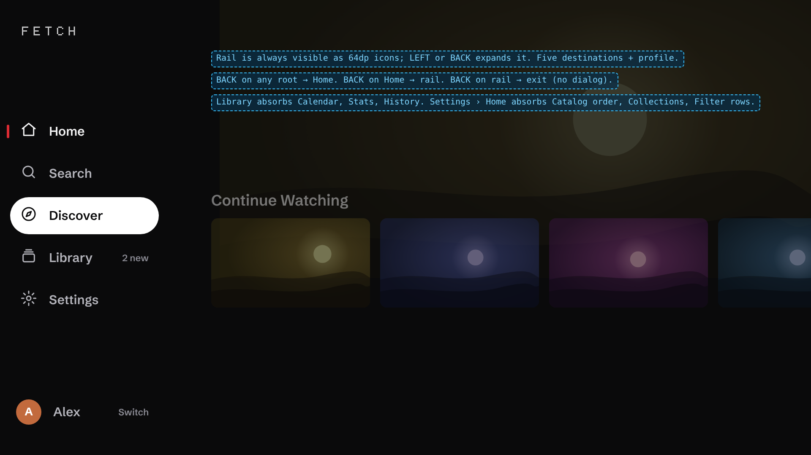

- Five destinations and the profile. Discover is promoted; Calendar, Stats and History move into Library.
- The rail is always visible as icons inside the safe area, so there is always a visible way out.
- Back: non-Home root → Home; Home → rail; rail → exit.

#### Home

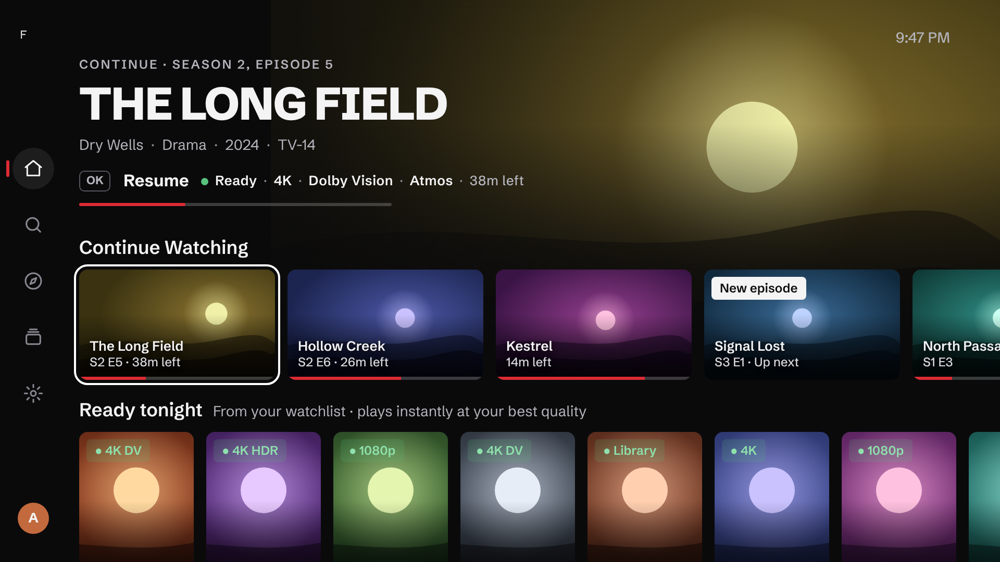

- The hero keeps its job (say what OK does) in less height, so two rows are visible.
- The Fetch line carries the ready dot: "● Ready · 4K · Dolby Vision · Atmos".
- Continue Watching cards carry their own label and time left; "New episode" is a badge.
- "Ready tonight" explains itself in its header.
- Cards are 188×106 dp and 110×165 dp, close to Google's 4-up and 5-up widths, giving about 4.5 landscape or 7 poster cards per row.

#### Detail

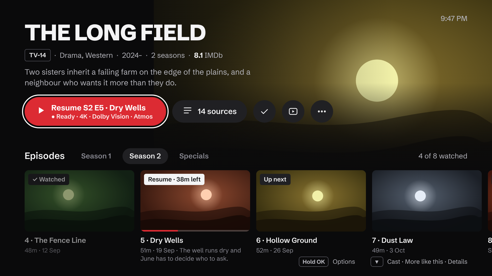

- The hero is about 250 dp. Season tabs and the episode row are on the first screen.
- One action row: Play (two lines), "14 sources", library, trailer, more. The duplicate Sources row is gone.
- The next episode is marked in the real episode row, instead of cloning the season into the hero.
- Hints for long-press and for what is below.

#### Search

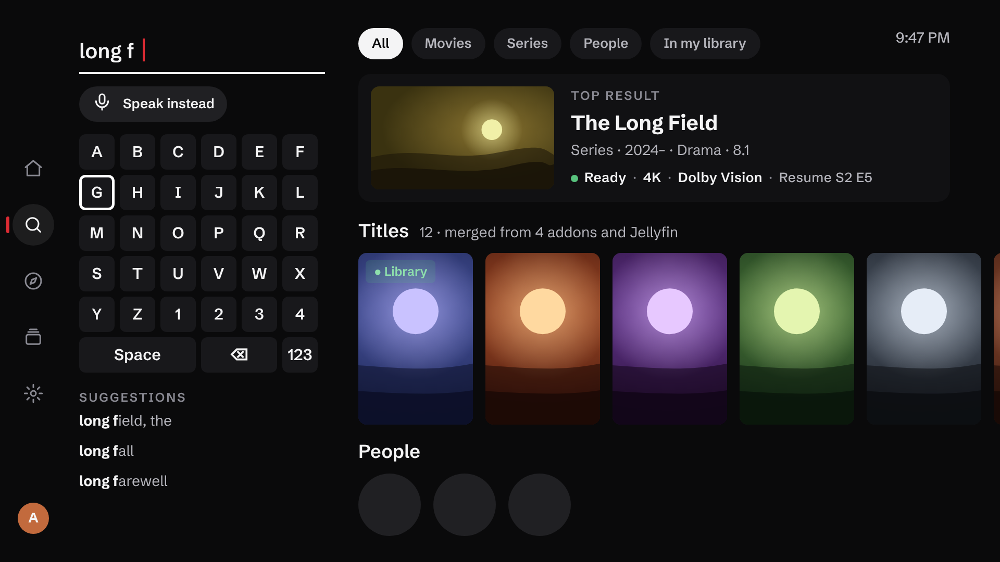

- A grid keyboard on the left keeps results visible while typing, which a full-screen IME cannot do. Voice stays one press away. The system IME remains available as a setting, since phone-hub typing and Bluetooth keyboards go through it.
- One merged, de-duplicated result set with a top result that carries the Fetch line.
- Type filters, including "In my library".

#### Player

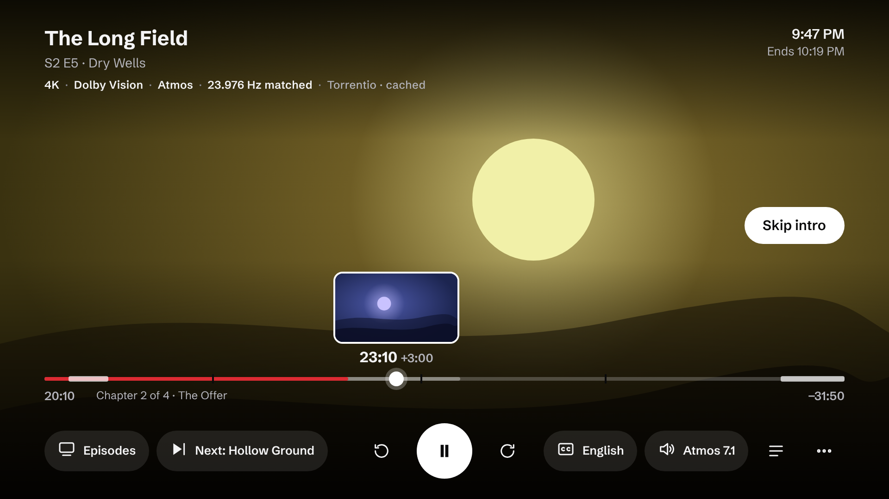

- Seeking shows the target time and the delta at the playhead. A thumbnail appears only where a source provides one (media-server trickplay); otherwise the time alone.
- Skip segments and chapters are drawn on the bar.
- Elapsed on the left, remaining on the right, "Ends at" under the clock.
- Subtitle and audio buttons show the current choice.
- The spec line confirms what is playing, including the matched refresh rate.

#### Sources

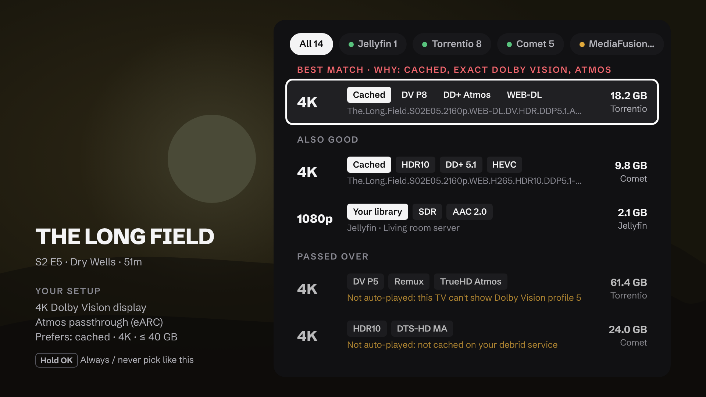

- "Why this one" in one line above the pick; "why not" in one line on each passed-over file.
- "Your setup" on the left states what Fetch believes about the display and audio chain, which is what the ranking depends on.
- Rows, not cards: the filename is one truncated line, never wrapped mid-token.

#### Library

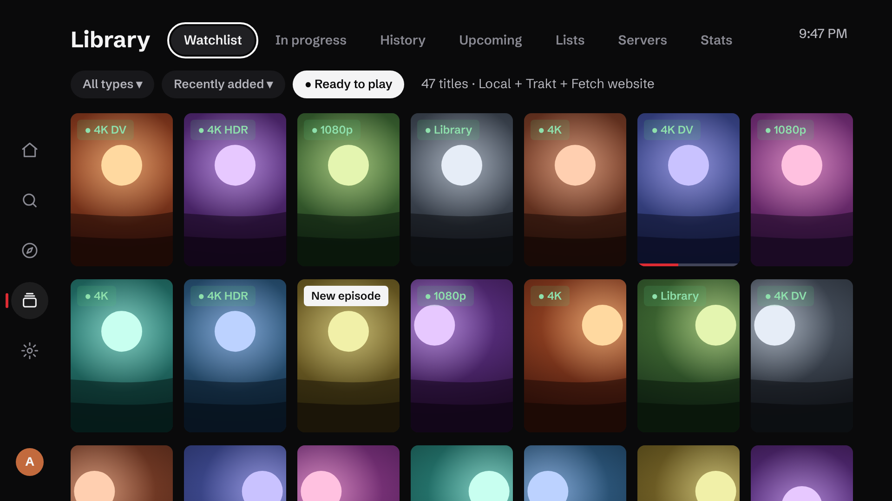

- One title row with tabs: Watchlist, In progress, History, Upcoming, Lists, Servers, Stats.
- One filter row. "Ready to play" is the filter no other app can offer.
- Posters start in the top quarter of the screen, three rows visible.
- Sources are merged, and the header says which.

---

## 16. Prioritised improvement roadmap

Seven initiatives, each building toward the thesis in section 5. Priorities follow the definitions in the brief: **P0** critical to core function, reliability or basic quality; **P1** high-impact; **P2** meaningful refinement; **P3** polish.

Complexity: **S** under a day, **M** days, **L** weeks. "Measure" says how to know it worked; Fetch has no telemetry, so every measure is a test, a benchmark or a scripted press count.

### Overview

| ID | Item | Priority | Complexity |
|---|---|---|---|
| **A** | **Prove it** | | |
| A1 | Measure on real devices and fill `docs/performance.md` | P0 | S, needs devices |
| A2 | Regenerate baseline and start-up profiles; CI check | P0 | S |
| A3 | CI gates: lint, release build, instrumented tests | P1 | M |
| A4 | First public release with a real smoke test | P0 | M |
| **B** | **Fix the core loop** | | |
| B1 | Fix the resume comparator | P0 | S |
| B2 | Recover from failures after playback has started | P0 | M |
| B3 | Plain-language playback errors | P1 | S |
| B4 | Seek feedback and one set of seek steps | P1 | M |
| B5 | Binge defaults | P1 | S |
| B6 | Completion threshold and Watch Next types | P2 | S |
| B7 | Skip segments and chapters on the scrubber | P2 | M |
| B8 | Lists instead of cycle buttons | P3 | S |
| **C** | **Navigation and information architecture** | | |
| C1 | Correct the Back model | P0 | S |
| C2 | Five-destination rail inside the safe area | P1 | M |
| C3 | Library as the personal hub | P1 | L |
| C4 | One "Customise Home"; addons at the first level | P1 | M |
| C5 | Focus hand-off fixes | P1 | S–M |
| C6 | Confirm successful actions; hint long-press | P1 | S |
| C7 | One key-repeat modifier and one screen-padding token | P2 | M |
| **D** | **Redesign the four screens people live in** | | |
| D1 | Detail page: episodes above the fold | P1 | M |
| D2 | Home: density, See all, new episodes | P1 | M |
| D3 | Search: merged results | P1 | L |
| D4 | Best-match preview: privacy and cost | P1 | S |
| D5 | Sources: explain the ranking | P2 | M |
| D6 | Discover: rebuild or fold into Search | P2 | M |
| D7 | Settings: Essential by default, fewer categories | P2 | M |
| **E** | **Subtract** | | |
| E1 | Privacy disclosures; parental guide opt-in | P0 | S |
| E2 | Remove the Supabase backend and watch party | P1 | M |
| E3 | Contain the YouTube client | P2 | M |
| E4 | Delete fork leftovers; documentation truth pass | P1 | S |
| E5 | Desktop as a personal tool; narrow the website | P1 | S |
| E6 | Remove the `playstore` flavour | P2 | S–M |
| **F** | **Design system** | | |
| F1 | Three fixes: panel theme import, 11.9 sp, accent as text | P1 | S |
| F2 | Component layer: button, media card, chip, spec line, focus spec | P1 | L |
| F3 | Token cleanup and scales | P2 | M |
| F4 | Guardrails and screenshot tests | P2 | M |
| F5 | Accessibility: motion, timeouts, screen reader, focus on light accents | P2 | M |
| **G** | **Engineering foundations** | | |
| G1 | Library decode off the main thread | P1 | S |
| G2 | Stop background wake-ups | P1 | S |
| G3 | Lazy start-up injection | P1 | S–M |
| G4 | Keep rules for Gson-persisted classes | P1 | S |
| G5 | Persistence: debounce shadow copies, then Room | P2 | S, then L |
| G6 | Explicit profile id | P2 | L |
| G7 | Player state: one active overlay, narrow state, request ids | P2 | L |
| G8 | Memory: available-memory cap and trim handling | P2 | M |

---

### Initiative A: Prove it

**Why first.** Every quality claim in this report and in the README is provisional until the app has run on the hardware it targets.

#### A1. Measure on real devices · P0 · Performance · S (needs devices)

- **Current state:** `docs/performance.md` defines the procedure; every results table is empty. Macrobenchmarks and `scripts/perf_baseline.sh` exist.
- **Problem:** No start-up, frame or memory number exists. The doc lists Fire OS 5 (API 22) as a target although `minSdk` is 24.
- **Proposal:** Run cold start, frame timing and the heap procedure on one Chromecast with Google TV HD and one Android-based Fire TV Stick (Fire OS 6 or later). Record build commit and firmware. Correct the device table.
- **Why better:** It turns every "likely" in section 12 into a fact or a non-issue, and decides the order of initiative G.
- **User impact:** Indirect but total: it is how the low-end promise becomes true.
- **Dependencies:** A release build; two devices.
- **Files:** `docs/performance.md`, `baselineprofile/`, `scripts/perf_baseline.sh`.
- **Acceptance:** All four tables filled for both devices; total PSS during 1080p playback recorded against Google's 280 MB limit for 1 GB devices.
- **Measure:** The tables themselves, re-run at each release.

#### A2. Regenerate baseline and start-up profiles · P0 · Performance · S

- **Current state:** `startup-prof.txt` and `baseline-prof.txt` are byte-identical (98,862 lines); recorded on upstream NuvioTV.
- **Problem:** Start-up layout optimisation is effectively off; Fetch-only code is not precompiled.
- **Proposal:** Run `BaselineProfileGenerator` on an API 33+ emulator; commit. Add a CI check that the two files differ and that Fetch packages are covered.
- **Why better:** Cheap, and it affects every install and update.
- **User impact:** Faster first launches and less jank in the first sessions.
- **Dependencies:** An emulator.
- **Files:** `app/src/main/generated/baselineProfiles/`, `baselineprofile/`.
- **Acceptance:** Files differ; the start-up profile is much smaller; `StartupBenchmark` shows the profile build beating no profile.
- **Measure:** Time to initial display with `CompilationMode.None` versus `Partial(Require)`.

#### A3. CI gates · P1 · Engineering · M

- **Current state:** Pull requests run unit tests and a debug assemble.
- **Problem:** No lint, no release/R8 build, no instrumented tests.
- **Proposal:** Add `lintFullDebug`, `assembleFullRelease` with a debug key, and the 45 instrumented tests on an emulator. (No `playstore` job: that flavour is removed in E6.)
- **Why better:** R8, keep-rule and flavour regressions surface on the pull request, not in a manual release.
- **User impact:** Fewer broken releases.
- **Dependencies:** None.
- **Files:** `.github/workflows/ci.yml`.
- **Acceptance:** All three jobs required on `main`.
- **Measure:** Count of release-only regressions (should go to zero).

#### A4. First public release with a real smoke test · P0 · Product · M

- **Current state:** "#14 first release" is open. `release_test_cases.csv` is the upstream mobile and iOS plan.
- **Problem:** There is no test plan for this product and no released build.
- **Proposal:** Replace the CSV with a TV smoke test of about 30 cases built from the workflows in section 6.3. Run it on three devices (the two above and a Shield or equivalent). Tag a release.
- **Why better:** Real users find what static reading cannot.
- **User impact:** The product exists.
- **Dependencies:** A1, A2, B1, B2, C1, E1.
- **Files:** `docs/releasing.md`, `release_test_cases.csv`.
- **Acceptance:** Smoke test passes on three devices; a signed release is published.
- **Measure:** Issues filed per release, by area.

---

### Initiative B: Fix the core loop

**Why.** Resume, play, seek, next episode and recover are the product. They must be boringly reliable before anything is redesigned.

#### B1. Fix the resume comparator · P0 · Detail · S

- **Current state:** `resolveNextToWatchLatestProgress` uses `maxWithOrNull(compareByDescending { it.lastWatched }…)`.
- **Problem:** The maximum under a descending comparator is the oldest entry. With two or more half-watched episodes and a non-resumable latest entry, Play resumes the stalest one.
- **Proposal:** Use an ascending comparator (`compareBy(lastWatched).thenBy(season).thenBy(episode)`) with `maxWithOrNull`. Add a test with two resumable entries.
- **Why better:** The Play button is the product's main promise; it must name the right episode.
- **User impact:** Correct resume for anyone who hops between episodes.
- **Dependencies:** None.
- **Files:** `ui/screens/detail/NextToWatchProgress.kt:10-16`; `app/src/test/.../NextToWatchProgressTest.kt`.
- **Acceptance:** New test fails before the change and passes after; existing tests pass.
- **Measure:** The test.

#### B2. Recover from failures after playback has started · P0 · Player · M

- **Current state:** Automatic retry and next-source apply only before the first frame. 400/401/403/404/410 are never retried. The error screen offers "Choose another source".
- **Problem:** An expired debrid link mid-film, the most likely failure after a long pause, ends in an exit.
- **Proposal:** On 401/403/410 or a source error after first frame: (1) re-resolve the same stream through its addon and resume at the saved position; (2) if that fails, try the next ranked source at the saved position; (3) only then show the error, with **Retry**, **Try next source** and **All sources** buttons.
- **Why better:** Recovery in place is what Plex does and what users expect; Fetch already has the ranked list and the position.
- **User impact:** High. Removes the most frustrating failure in the app.
- **Dependencies:** Position must be saved at failure (it is).
- **Files:** `ui/screens/player/PlayerRuntimeControllerSourceFailover.kt:28-87`, `PlayerRuntimeControllerErrorRecovery.kt:39-76`, `PlayerScreen.kt:4179-4335`.
- **Acceptance:** With a link forced to 410 mid-playback, playback resumes within the first-frame timeout at the same position with no user input; with all sources failing, the error screen shows three actions and focus on Retry.
- **Measure:** Policy tests for the three branches; a manual expired-link case in the smoke test.

#### B3. Plain-language playback errors · P1 · Player · S

- **Current state:** `HTTP 404 Not Found [ERROR_CODE_IO_BAD_HTTP_STATUS]` followed by a hint.
- **Problem:** The first thing the user reads is a constant.
- **Proposal:** Lead with one sentence in plain words ("This link has expired", "This file can't be played on this TV"); put the code in a small detail line for reports.
- **Why better:** Tells the user what to do next.
- **User impact:** Medium.
- **Dependencies:** Best done with B2.
- **Files:** `PlayerRuntimeControllerErrorRecovery.kt:113-150`; strings.
- **Acceptance:** Every error class has a plain sentence; codes never appear in the title.
- **Measure:** String review; snapshot test of the error screen.

#### B4. Seek feedback and one set of seek steps · P1 · Player · M

- **Current state:** A bare bar and "position / duration" for 1.5 s. D-pad ±10 s (ramping to 60 s); buttons −10 s / +30 s; not configurable.
- **Problem:** The most-used interaction gives the least information, and its two entry points disagree.
- **Proposal:** Show the target time and a signed delta above the playhead; keep it until commit plus 1.5 s. One configurable pair of steps (default 10 s back, 30 s forward) used by keys and buttons, with labels drawn from it. Show a thumbnail only where the source supplies one.
- **Why better:** Matches what Netflix, Apple TV and Infuse show, without needing thumbnails that debrid streams cannot provide.
- **User impact:** High; felt in every session.
- **Dependencies:** None.
- **Files:** `PlayerScreen.kt:3692-3737, 3174-3178`; `PlayerScrubRates.kt`; `PlayerRuntimeControllerTrackSelection.kt:36`.
- **Acceptance:** Target time and delta visible during any seek; keys and buttons use the same steps; a setting changes both.
- **Measure:** Policy tests for step selection; screenshot test of the overlay.

#### B5. Binge defaults · P1 · Player · S

- **Current state:** Next-episode auto-play off; still-watching off; card at 99% without markers; 3 s countdown.
- **Problem:** The default experience does not chain episodes, and the prompt arrives during the last seconds.
- **Proposal:** Default auto-play on with the still-watching prompt on (after 3 episodes, as today). Without markers, show the card a fixed time before the end for episodes (minutes mode) instead of 99%. Lengthen the countdown to about 8 s and make it a setting.
- **Why better:** It is the convention, and the still-watching prompt keeps it safe.
- **User impact:** High for series viewers.
- **Dependencies:** None. Kids profiles keep their autoplay cap.
- **Files:** `data/local/PlayerSettingsDataStore.kt` (`PlayerSettings`); `ui/screens/player/PlayerNextEpisodeRules.kt`; `PlayerUiState.kt:66`.
- **Acceptance:** A fresh profile auto-plays the next episode with a visible, cancellable countdown; existing profiles keep their stored choice.
- **Measure:** Existing next-episode policy tests extended for the new defaults.

#### B6. Completion threshold and Watch Next types · P2 · Player · S

- **Current state:** Watched at a flat 90%. Watch Next entries are all `CONTINUE`.
- **Problem:** Long films lose their resume point up to 18 minutes early. Next-up episodes are published with the wrong type.
- **Proposal:** Completed when credits markers say so, else at the lesser of 90% and "duration minus about 3 minutes". Publish next-up episodes as `WATCH_NEXT_TYPE_NEXT`.
- **Why better:** Matches Google's Watch Next rules.
- **User impact:** Medium.
- **Dependencies:** Check Trakt and Simkl scrobble thresholds stay consistent.
- **Files:** `shared/.../domain/model/WatchProgress.kt:46`; `core/recommendations/ProgramBuilder.kt:35`.
- **Acceptance:** A 180-minute film stopped at 165 minutes resumes; a next-up episode appears as "Next" in the launcher.
- **Measure:** Unit tests on thresholds.

#### B7. Skip segments and chapters on the scrubber · P2 · Player · M

- **Current state:** Skip segments are loaded and drive the Skip button; nothing is drawn on the bar. No chapter support.
- **Proposal:** Draw intro, recap and credits segments on the bar now. Add container chapters as a second step.
- **Why better:** Makes seeking purposeful; Infuse, Kodi and Plex show chapters.
- **User impact:** Medium.
- **Dependencies:** B4.
- **Files:** `ui/screens/player/PlayerProgressFill.kt`; `PlayerScreen.kt:3515`.
- **Acceptance:** Segments visible whenever markers exist; no extra recomposition while playing.
- **Measure:** Screenshot test; recomposition count unchanged.

#### B8. Lists instead of cycle buttons · P3 · Player · S

- **Proposal:** Sleep timer and aspect open short lists with Off or Fit first.
- **Files:** `core/player/SleepTimer.kt:37-86`; `PlayerScreen.kt:2933-2941`.
- **Acceptance:** Cancelling a timer is two presses.

---

### Initiative C: Navigation and information architecture

**Why.** A user cannot value what they cannot find, and cannot trust a Back key that exits.

#### C1. Correct the Back model · P0 · Navigation · S

- **Current state:** Back on any root opens the sidebar; the next Back exits with no prompt by default. Empty-state actions push roots without `popUpTo`.
- **Problem:** Two presses from Settings close the app. Back from a pushed Search cannot return to Calendar.
- **Proposal:** Non-Home root → Home. Home → rail. Rail → exit, with no dialog. Empty-state actions pop back to their caller.
- **Why better:** Keeps Google's left-navigation rule on Home and removes the trap elsewhere.
- **User impact:** High; this is felt as "the app keeps closing".
- **Dependencies:** None.
- **Files:** `MainActivity.kt:1575-1583`; `ui/navigation/FetchNavHost.kt:1220-1244`.
- **Acceptance:** From Settings, exiting takes three Back presses via Home; Back from a Search opened from Calendar returns to Calendar.
- **Measure:** A navigation test for each root.

#### C2. Five-destination rail inside the safe area · P1 · Navigation · M

- **Current state:** Four default items; icons 9–13 dp from the edge; Discover hidden by default; two width tokens.
- **Proposal:** Home, Search, Discover, Library, Settings, and the profile. Icons at least 27 dp from the edge. One width token. Remove the "Discover location" setting.
- **Why better:** Five to six destinations is Google's advice; the Plex reversal shows a left rail suits multi-source apps.
- **User impact:** High for discoverability.
- **Dependencies:** D6 decides what Discover is.
- **Files:** `MainActivity.kt:1143-1201`; `ui/components/FloatingSidebarButton.kt`; `ui/theme/SizeTokens.kt:107`; `ComponentTokens.kt:133`.
- **Acceptance:** Five items visible by default; no rail element inside the outer 5%.
- **Measure:** Screenshot test with a 5% overlay.

#### C3. Library as the personal hub · P1 · Library · L

- **Current state:** One source at a time under three to four rows of controls; Stats and Calendar are header buttons; no history.
- **Proposal:** Tabs: Watchlist, In progress, History, Upcoming, Lists, Servers, Stats. One filter row (type, sort, "Ready to play"). Local lists shown alongside the connected provider. Rename Home "Collections" to "Home folders".
- **Why better:** One place for "my things"; posters in the top quarter; history finally exists.
- **User impact:** High.
- **Dependencies:** A history query over watched items (benefits from G5); the ready check from `HomeReadyChecker`.
- **Files:** `ui/screens/library/`; `ui/screens/stats/`; `ui/screens/calendar/`; `shared/.../domain/model/LibraryModels.kt`.
- **Acceptance:** At least two full poster rows visible on entry; a title watched last month is findable in History within five presses of opening the Library.
- **Measure:** Press-count script; layout test at 960×540 dp.

#### C4. One "Customise Home"; addons at the first level · P1 · Settings · M

- **Current state:** Catalog order, Collections and Filter rows are cards inside the addon manager, under "Content & discovery".
- **Proposal:** Settings › Home › Customise Home, one screen listing rows with reorder, hide, pin, and "Add row" (from a catalog, a filter, or a folder). Also reachable from a row title's long-press on Home. Addons becomes a first-level Settings entry named "Addons".
- **Why better:** The main customisation tool sits where users look for it; three tools become one.
- **User impact:** Medium–high.
- **Dependencies:** None.
- **Files:** `ui/screens/addon/CatalogOrderScreen.kt`; `ui/screens/collection/`; `ui/screens/filterrows/`; `ui/screens/settings/SettingsCatalog.kt`.
- **Acceptance:** Reordering a Home row takes at most six presses from Home.
- **Measure:** Press-count script.

#### C5. Focus hand-off fixes · P1 · TV UX · S–M

- **Current state:** Closing the rail with Right does not hand focus back; Discover has no initial focus; several screens request focus after fixed delays.
- **Proposal:** Explicit focus request to the page's last-focused item when the rail closes. Initial focus on Discover. Replace delay-based requests with frame-based helpers already in the code (`requestFocusAfterFrames`).
- **Why better:** Removes the "nothing is focused" class of bug on slow devices.
- **User impact:** High when it bites.
- **Dependencies:** Device verification of the rail case (A1 devices).
- **Files:** `MainActivity.kt:1641-1645`; `ui/screens/search/SearchDiscoverSection.kt`; `SearchScreen.kt:462,498`; `LibraryScreen.kt:216-261`.
- **Acceptance:** After any rail close, exactly one element is focused within two frames, on a low-end device.
- **Measure:** Compose focus tests per root; manual check with animator scale at 10×.

#### C6. Confirm successful actions; hint long-press · P1 · UX · S

- **Proposal:** A brief confirmation when a title is added, removed or marked watched from the poster menu. A one-line hint ("Hold OK for options") on first focus of a card per profile, and persistently on the detail page.
- **Files:** `ui/components/posteroptions/PosterOptionsController.kt:199-216`.
- **Acceptance:** Every poster-menu action produces visible feedback.

#### C7. One key-repeat modifier and one screen-padding token · P2 · TV UX · M

- **Current state:** Three key-repeat schemes; none on Settings, Calendar, Stats, addon manager. Edge padding of 32, 36, 48, 52 and 56 dp.
- **Proposal:** One modifier applied to every scrolling container; `spacing.screen` used by every screen.
- **Files:** `ui/util/DpadFastScrollModifier.kt`, `DpadThrottleModifier.kt`; `ui/theme/SpacingTokens.kt`.
- **Acceptance:** Holding a direction behaves the same on every list; no screen has content inside 48/27 dp.
- **Measure:** Guard test on screen-padding literals.

---

### Initiative D: Redesign the four screens people live in

Concepts are in section 15.3.

#### D1. Detail page: episodes above the fold · P1 · Detail · M

- **Current state:** 540 dp hero; a duplicate Sources row; a cloned season row when resuming.
- **Proposal:** Hero of about 250–300 dp for series. One action row: Play, "N sources", library, trailer, more. Remove the Best match card and the hero's up-next row; mark the next episode in the real episode row and focus Play.
- **Why better:** The first screen answers "what is this, what will play, what else is there".
- **User impact:** High.
- **Dependencies:** F2 helps (shared button and chip) but is not required.
- **Files:** `ui/screens/detail/HeroSection.kt:198`; `MetaDetailsScreen.kt:1346-1353, 2686-2708`; `DetailSourcesRow.kt`.
- **Acceptance:** On a series at 960×540 dp, season tabs and the top of the episode row are visible on entry; playing a specific episode in the current season takes Down ×2, Left/Right, OK.
- **Measure:** Screenshot test; press-count script.

#### D2. Home: density, See all, new episodes · P1 · Home · M

- **Current state:** About four cards and one row; no See all; no new-episode surfacing; the ready dot unexplained.
- **Proposal:** Shorter hero text block so two rows show. A See-all card at the end of each row (forward the existing callback). "New episode" badge on Continue Watching from the calendar data. A one-line explanation in the "Ready tonight" header.
- **Why better:** Netflix lost goodwill by cutting density; Fetch should go the other way.
- **User impact:** High.
- **Dependencies:** None for See all (the grid screen exists).
- **Files:** `ui/screens/home/HomeScreen.kt:85`; `ModernHomeContent.kt:1064`; `ReadyTonight.kt`.
- **Acceptance:** Two rows fully visible on entry; any Home row reaches its grid in one press from its last card.
- **Measure:** Frame-timing benchmark before and after (must not regress); screenshot test.

#### D3. Search: merged results · P1 · Search · L

- **Current state:** One row per addon catalog; duplicates; no type filter; system IME over a Material 3 field.
- **Proposal:** Merge by id across addons and servers; rank; show a top result with the Fetch line; type filters including "In my library". Offer an in-app grid keyboard that keeps results visible, with the system IME as a setting.
- **Why better:** The best match is first, and typing does not hide results.
- **User impact:** High.
- **Dependencies:** A dedupe key (IMDb/TMDB id, with a title-and-year fallback).
- **Files:** `ui/screens/search/SearchViewModel.kt`, `SearchScreen.kt`.
- **Acceptance:** A title returned by four addons appears once; the top result is focusable in one press from the keyboard.
- **Measure:** Unit tests on merge and rank with fixtures.

#### D4. Best-match preview: privacy and cost · P1 · Detail · S

- **Current state:** Every detail page queries every stream addon after 900 ms, by default.
- **Proposal:** Use the cached pick when fresh; otherwise query after a longer dwell or when Play gains focus and holds it; state the trade-off in the setting.
- **Why better:** Keeps the feature, cuts requests and what addons learn.
- **User impact:** Medium; protects debrid rate limits.
- **Files:** `core/streams/BestMatchPreviewer.kt:150-156`; `ui/screens/detail/MetaDetailsViewModel.kt:80, 135-156`.
- **Acceptance:** Browsing ten titles without pausing issues no stream requests.
- **Measure:** A request-count test.

#### D5. Sources: explain the ranking · P2 · Sources · M

- **Proposal:** A one-line "why" above the pick; rows instead of cards with single-line truncated filenames; a "Your setup" summary of the display and audio capabilities the ranking used; keep timed-out addons visible as failed.
- **Files:** `ui/screens/stream/StreamScreen.kt`; `SourceGroups.kt`; `shared/.../ranking/StreamRanker.kt`.
- **Acceptance:** For any two eligible streams, the screen shows the factor that ordered them.

#### D6. Discover: rebuild or fold into Search · P2 · Discover · M

- **Proposal:** Either give Discover real filters across catalogs (type, genre, year, rating, sort, scroll paging) or remove it and let Search's empty state carry genre shortcuts, as Netflix does. Decide before C2 ships.
- **Recommendation:** Rebuild; a rail destination needs to earn its place.
- **Files:** `ui/screens/search/SearchDiscoverSection.kt`.

#### D7. Settings: Essential by default, fewer categories · P2 · Settings · M

- **Proposal:** Present Essential as "Settings" and Advanced as a clearly separate layer. Merge the ten Playback entries into four. Bring edge padding to the safe area. Remove settings that only multiply Home code paths (three Continue Watching styles, expand-on-focus, trailer targets) after checking they are not widely used.
- **Files:** `ui/screens/settings/SettingsCatalog.kt`, `EssentialSettingsIndex.kt`.
- **Acceptance:** Advanced has at most 14 rail entries.

---

### Initiative E: Subtract

**Why.** One person cannot validate this surface. Every removal makes the rest more finishable.

#### E1. Privacy disclosures; parental guide opt-in · P0 · Trust · S

- **Current state:** Parental guide on by default, sending IMDb ids to a hard-coded third-party host; three more undisclosed hosts.
- **Proposal:** Make the parental guide opt-in; name every third-party host in `PRIVACY.md`; self-host the phone-page fonts.
- **Why better:** "Private" is a headline claim; it must be literally true.
- **Files:** `data/local/PlayerSettingsDataStore.kt:292`; `core/di/NetworkModule.kt:325`; `core/server/AddonWebPage.kt`; `PRIVACY.md`.
- **Acceptance:** A fresh install contacts only hosts the user configured, plus those named in the policy.
- **Measure:** A network-log check in the smoke test.

#### E2. Remove the Supabase backend and watch party · P1 · Scope · M

- **Current state:** Release builds resolve the server to `sync.invalid`; the repo has no server for it; only this backend enables watch party. The owner has confirmed it is not used and will not be.
- **Problem:** About 2k lines of auth, 3.5k of party code on TV and 2.7k on desktop, a second HTTP stack (Ktor) and a realtime client, all built on every process start, for a path nobody takes. Every sync change is made twice.
- **Proposal:** Delete the backend, `core/auth/`, `core/party/`, `ui/screens/party/`, the avatar and background repositories tied to it, the desktop party code, and the Supabase and Ktor dependencies if nothing else needs them. Keep the `SyncBackend` interface with the website as its only implementation. Remove "Supabase-compatible" from Settings › Account › Sync.
- **Why better:** One sync story (local, or the website for watchlist, history and settings), a smaller start-up graph and a smaller APK.
- **User impact:** None visible; faster start and fewer settings.
- **Dependencies:** None. No deprecation period is needed.
- **Files:** `core/sync/backend/SupabaseSyncBackend.kt`, `core/auth/`, `core/party/`, `ui/screens/party/`, `data/remote/supabase/`, `core/di/SupabaseModule.kt`, `desktop/.../party/`.
- **Acceptance:** Builds and tests pass with the modules removed; no Supabase or party symbol remains.
- **Measure:** APK size and cold-start time before and after, on the A1 devices.

#### E3. Contain the YouTube client · P2 · Scope · M

- **Current state:** About 6.3k lines on TV and 2.7k on desktop. `YouTubeResponseParser.kt` (716 lines) and `YouTubeStoryboard.kt` are byte-identical in both apps. It depends on undocumented YouTube internals, and a CI workflow exists to detect breakage. The owner uses it, so it stays.
- **Problem:** It is the part of the app most likely to break without warning, and each fix is made twice.
- **Proposal:** Move the parser, storyboard and client into `shared/` so there is one copy. Keep YouTube out of start-up and out of Home's loading path (a failed YouTube row must not delay or break Home). Keep its rail item conditional on sign-in, as today. Treat the breakage workflow as its test suite and keep it.
- **Why better:** Keeps a feature the owner values at roughly half its upkeep, with its failures fenced off.
- **User impact:** None when it works; a broken YouTube no longer costs anything outside YouTube.
- **Dependencies:** None.
- **Files:** `data/youtube/`, `ui/screens/youtube/`, `desktop/.../youtube/`, `shared/`.
- **Acceptance:** One parser in `shared/` used by both apps; Home renders normally with the YouTube endpoints unreachable.
- **Measure:** A test that loads Home with YouTube failing; lines of duplicated code at zero.

#### E4. Delete fork leftovers; documentation truth pass · P1 · Hygiene · S

- **Proposal:** Delete membership stubs, report repositories, the speed test, dead flags, dead keep rules and stability entries, the dead tokens of section 14.2, and `CwStylePreview`. Fix every row in section 2.6, including the stale screenshots and `docs/ROADMAP.md:65`.
- **Acceptance:** A dead-code scan is clean for the listed items; README and docs match the code.

#### E5. Desktop as a personal tool; narrow the website · P1 · Strategy · S

- **Current state:** The desktop chases parity with the TV (`docs/desktop-parity.md` says to update it whenever either app changes). The website still carries games and AI recommendations from its origin as a standalone tracker.
- **Proposal (desktop):** Keep it for the owner and friends. Delete the parity document and the parity goal. Default to external mpv playback. Remove desktop watch party with E2. Move duplicated clients into `shared/` when they are next touched. Never let desktop work gate a TV release.
- **Proposal (website):** State its purpose in the first paragraph of its README: the Fetch account server for watchlist, history and settings. Move games and AI recommendations out of the default navigation, or out of the repo.
- **Why better:** Each surface is budgeted for what it is.
- **Acceptance:** Both READMEs state the scope in their first paragraph; `docs/desktop-parity.md` is gone; the TV release checklist has no desktop step.

#### E6. Remove the `playstore` flavour · P2 · Scope · S–M

- **Current state:** Two flavours. `playstore` (`com.fetch.app`) disables in-app updates, in-app trailers, the YouTube section, the IMDb logo and custom server connections through `AppFeaturePolicy`. No store release is planned.
- **Problem:** Every feature gate is a second code path that must compile and behave, and nobody runs it.
- **Proposal:** Remove the flavour and its source set; fold `AppFeaturePolicy` into constants or delete the checks; keep a single `full` build. Set `android.software.leanback` to required in the remaining manifest so the TV app does not install on phones by accident.
- **Why better:** One build to test and release.
- **User impact:** None.
- **Dependencies:** None.
- **Files:** `app/build.gradle.kts` (flavours), `app/src/playstore/`, `app/src/full/`, `AppFeaturePolicy.kt`, `.github/workflows/`.
- **Acceptance:** `./gradlew :app:assembleRelease` produces the one APK set; no flavour dimension remains.

---

### Initiative F: Design system

#### F1. Three fixes · P1 · Design system · S

- Swap the non-TV `MaterialTheme` and `Text` imports in `StreamSourcesSidePanel.kt:26` and `EpisodesSidePanel.kt:30`.
- Remove the 0.85 scale in `ContinueWatchingSection.kt:84, 333`.
- Add an `accentText` role at 4.5:1 and use it at the 11 accent-as-text sites, starting with `DetailSourcesRow.kt:81`.
- **Acceptance:** In-player panels render the chosen font; the type-floor and contrast tests cover both cases.

#### F2. Component layer · P1 · Design system · L

- **Proposal:** Build `FetchButton`, `FetchIconButton`, `FetchMediaCard` (on `LightweightCard`), `FetchChip`, `FetchBadge`, `SpecLine` and one focus spec. Migrate screen by screen, starting with the four in initiative D.
- **Why better:** A redesign without this multiplies the 151 colour blocks; with it, D1–D3 are mostly composition.
- **Dependencies:** Best started before D1.
- **Acceptance:** Zero raw `Button(` in migrated screens; one card implementation in Home, Library and Search; chips look the same on detail and sources.
- **Measure:** A guard test counting raw `Button(` and `Card(` per directory, ratcheting down.

#### F3. Token cleanup and scales · P2 · Design system · M

- Delete dead tokens; resolve duplicates (sidebar width, poster size, safe area). Collapse the type scale; add a control-size scale; make `strokes.focus` the only way to draw a ring.
- **Acceptance:** A dead-token test passes; every public token has a use outside the theme.

#### F4. Guardrails and screenshot tests · P2 · Design system · M

- Extend the literal ratchet as in section 14.6. Add screenshot tests for Home, Detail, Search, Player and Library across theme × high contrast × font scale 1.3 using the existing Robolectric harness.
- **Acceptance:** A pull request that adds a raw focus scale or a non-TV Material import fails.

#### F5. Accessibility · P2 · Accessibility · M

- Separate reduced motion from low-RAM and add an in-app toggle. Make the control auto-hide delay a setting and extend it when a screen reader is on. Fix double-read poster titles and expose card progress. Draw the focus ring with a dark inner gap on light accents. Honour the system audio-description preference.
- **Acceptance:** A TalkBack pass on Home, Detail and Player with no duplicate announcements; focus contrast at least 3:1 in every theme.
- **Measure:** Semantics tests; the extended contrast test.

---

### Initiative G: Engineering foundations

#### G1. Library decode off the main thread · P1 · Performance · S

- **Proposal:** `flowOn(Dispatchers.Default)`, `distinctUntilChanged` on the raw set, a per-item decode cache, and one shared `stateIn` flow; move sort and tab preferences out of the library file.
- **Files:** `data/local/LibraryPreferences.kt:54-59, 229-263`; `ui/screens/detail/MetaDetailsViewModel.kt:474-493`.
- **Acceptance:** No Gson decode on the main thread on detail open with a 2,000-item library.
- **Measure:** StrictMode custom slow call; Perfetto main-thread slice.

#### G2. Stop background wake-ups · P1 · Performance · S

- **Proposal:** Remove the 15-minute periodic job (keep boot and `INITIALIZE_PROGRAMS`); gate the 60 s Trakt poll on process foreground.
- **Files:** `core/sync/androidtv/TvChannelRefreshJobService.kt`; `data/repository/TraktProgressService.kt:259`.
- **Acceptance:** `dumpsys jobscheduler` shows no periodic Fetch job; no network while backgrounded.
- **Measure:** `dumpsys procstats` over 24 hours.

#### G3. Lazy start-up injection · P1 · Performance · S–M

- **Proposal:** `dagger.Lazy` for the `MainActivity` and `Application` fields not needed before first frame; fix the defeated deferral at `MainActivity.kt:278`; drop `runBlocking` from the Supabase provider (moot after E2).
- **Acceptance:** Time to initial display improves on the A1 devices.
- **Measure:** `StartupBenchmark`.

#### G4. Keep rules for Gson-persisted classes · P1 · Reliability · S

- **Proposal:** `@Keep` (or kotlinx.serialization) for `PendingProgressUpsert`, `PendingWatchedUpsert`, `CachedNextUpItem`, `CachedInProgressItem` and any other reflectively persisted class; a release-build round-trip test.
- **Files:** `core/sync/WatchStateMutationStore.kt`; `data/local/ContinueWatchingEnrichmentCache.kt`; `app/proguard-rules.pro`.
- **Acceptance:** Upgrade between two release builds preserves the pending queue.

#### G5. Persistence · P2 · Architecture · S, then L

- **Step 1 (S):** Debounce shadow copies (once per store per 30 s and on `onStop`); write them through a temp file and rename.
- **Step 2 (L):** Move watched items, the progress archive, the library and pending mutations to Room. Keep DataStore for settings.
- **Why better:** Writes stop scaling with history; history becomes queryable (needed by C3); progress can be saved more often (section 10.4).
- **Acceptance:** Marking an episode watched with 5,000 watched items writes a bounded amount.
- **Measure:** A JVM benchmark at 100, 1,000 and 5,000 items.

#### G6. Explicit profile id · P2 · Architecture · L

- **Proposal:** Capture the profile id once per operation and pass it through repository boundaries; scope per-profile caches in one object replaced on switch.
- **Why better:** Removes the generator of the profile and Continue Watching races, instead of patching each one.
- **Files:** `core/profile/ProfileManager.kt:43-48`; the 96 functions with a defaulted profile parameter.
- **Acceptance:** No default parameter reads `activeProfileId.value`.

#### G7. Player state · P2 · Architecture · L

- **Proposal:** One `activeOverlay` value replacing the visibility booleans; narrow state flows per overlay (starting with `isLive`); pass a playback-request id through navigation and keep URL, headers and sources in a holder; on restore, re-resolve the stream.
- **Why better:** Makes B2, B4 and B7 safe to build; takes tokenised URLs out of saved state.
- **Files:** `ui/screens/player/PlayerUiState.kt`; `PlayerScreen.kt:217-2133, 2688`; `ui/navigation/Screen.kt:72`; `PlayerNavigationArgs.kt`.
- **Acceptance:** The controls overlay does not recompose on timeline ticks; no stream URL in any route string.
- **Measure:** Layout Inspector recomposition counts.

#### G8. Memory · P2 · Performance · M

- **Proposal:** Cap the playback buffer by a fraction of `availMem` at playback start; implement `onTrimMemory`.
- **Dependencies:** A1 heap data.
- **Acceptance:** Total PSS during playback within Google's limits on the 1 GB-class device.

---

## 17. Recommended implementation sequence

Dependencies decide the order. Each phase leaves the app shippable.

```text
Phase 0  Quick, safe, high value (days)
         B1 resume comparator · C1 Back model · E1 privacy · F1 three fixes
         G1 library decode · G2 background wake-ups · G4 keep rules · A2 profiles

Phase 1  Prove it (needs devices)
         A1 measurements · A3 CI gates · G3 lazy injection · C5 focus hand-off (verify on device)

Phase 2  Core loop
         B2 recovery · B3 error text · B4 seek feedback · B5 binge defaults · D4 preview cost
         → A4 first public release

Phase 3  Subtract (before any redesign, so there is less to redesign)
         E2 Supabase and party · E6 playstore flavour · E4 leftovers and docs · E5 desktop and website
         E3 contain YouTube (one shared parser)

Phase 4  Foundations for redesign
         F2 component layer (button, card, chip, spec line, focus) · C7 padding and key repeat

Phase 5  Redesign
         C2 rail · D1 detail · D2 Home · C4 Customise Home · C6 feedback and hints
         D3 search · C3 Library hub (after G5 step 2 if history needs it) · D6 Discover

Phase 6  Depth
         G5 Room · G6 profile id · G7 player state · G8 memory
         B6 thresholds · B7 scrubber marks · D5 sources · D7 settings
         F3 tokens · F4 guardrails · F5 accessibility · B8 lists
```

**Why this order.**

- **Phase 0 before measuring** because these are verified defects with small, local fixes, and A2 needs only an emulator.
- **Subtract before redesign** because every removed screen and setting is one fewer thing to restyle, migrate and test.
- **The component layer before the screens** because D1–D3 built on 165 hand-styled buttons would bake in the inconsistency.
- **Room and the player refactor last** because they are the largest and are justified by what the earlier phases need (history for C3; safe recovery and seeking for B2, B4, B7), not by tidiness. If B2 proves too risky on the current controller, pull the first part of G7 (`activeOverlay`) forward.

**If only five things get done:** B1, B2, C1, A1 with A2, and D1.

---

## 18. Acceptance criteria and success metrics

Fetch has no telemetry and should keep it that way. Success is therefore measured by tests, benchmarks and scripted press counts, all of which can run in CI or in the release smoke test.

### 18.1 Product-level targets

| Outcome | Metric | Today | Target |
|---|---|---|---|
| One press to picture | Presses from cold open to resumed playback | 1–2 | Keep at 1–2 |
| Episodes are visible | Episode row visible on series detail entry at 960×540 dp | No | Yes |
| Find a specific episode | Presses from detail entry to playing an episode in the current season | Down ×3 + n + OK | Down ×2 + n + OK |
| Back is safe | Back presses to exit from Settings | 2 | 3, via Home |
| Search finds it first | Position of an exact-title match with four addons | One per addon row | First, once |
| History exists | Presses to find a title watched last month | Not possible | 5 or fewer from Library |
| Recover in place | Expired link mid-film resumes without input | No | Yes |
| Home density | Fully visible rows on Home entry | 1 | 2 |
| Seeking is legible | Target time shown during seek | No | Yes |

### 18.2 Performance targets (to be set from A1)

I will not invent numbers. Record the baseline first; then hold these.

| Metric | Source of the bar |
|---|---|
| Time to initial display, cold, with baseline profile | Baseline from A1; must improve after A2 and G3 |
| Home scroll frame overrun at P90 and P99 | Baseline from A1; must not regress after D2 |
| Total memory during 1080p playback on a 1 GB-class device | Google: 280 MB or less |
| Media buffer | Google: 40–60 MB at 1 GB/1080p; 100–120 MB at 2 GB/4K |
| Background process starts per day | 0 periodic (after G2) |
| Main-thread work on detail open with a 2,000-item library | No JSON decode (after G1) |

### 18.3 Quality gates

| Gate | Check |
|---|---|
| Focus | Exactly one focused element after every navigation, rail close and dialog dismissal (Compose focus tests) |
| Safe area | No interactive content inside 48/27 dp (guard test) |
| Contrast | Text 4.5:1, focus indicator 3:1, in every theme, including accent-as-text (extended `ThemeContrastTest`) |
| Type | Nothing under 12 sp including scaled styles (extended `TypeScaleFloorTest`) |
| Components | Raw `Button(` and `Card(` counts ratchet down per directory |
| Privacy | A fresh install contacts only configured and disclosed hosts |
| Release | Lint, release build and instrumented tests pass on every pull request |
| Profiles | Baseline and start-up profiles differ and cover Fetch packages |

---

## 19. Risks, dependencies and open questions

### 19.1 Risks

| Risk | Likelihood | Impact | Mitigation |
|---|---|---|---|
| A static finding turns out wrong on a device (focus after rail close, IME suggestions, clipping at 1.3× font scale) | Medium | Low | Each is labelled a hypothesis; verify in phase 1 before fixing. |
| Refactoring the player or detail composables introduces focus regressions | High | High | Policy tests exist; add focus tests first; change one concern per pull request. |
| Moving stores to Room loses data on migration | Medium | High | Migrate one store at a time; keep the DataStore file until a release later; round-trip tests. |
| A YouTube change breaks the YouTube section | High over time | Low | Contained by E3: one parser, fenced off from Home and start-up. |
| Changing binge defaults surprises existing users | Low | Low | Apply to new profiles only. |
| A denser Home regresses frame times on sticks | Medium | Medium | Gate D2 on the frame benchmark from A1. |
| Fire TV moves to Vega OS | Certain over time | Medium | Treat Google TV as primary; keep Fire OS support while devices exist. |
| Sideloading verification adds install friction from 2027 | Unknown for TV | Medium | GitHub is the only channel, so watch this closely; document the ADB install route in the README. |
| YouTube changes break trailers | High | Low | Keep trailers as a hand-off, not a client. |

### 19.2 Dependencies

- A1 needs two physical devices. Everything in section 12.4 waits on it.
- A2 and A3 need an emulator in CI.
- C3's History tab is easier after G5 step 2.
- D1–D3 are cheaper after F2.
- B2, B4 and B7 are safer after the first part of G7.
- E2 removes the need for one of G3's fixes.

### 19.3 Assumptions made

- The primary user is the enthusiast described in section 2.1, and the household is a real secondary audience. If the household is the primary audience, Essential mode and kids rules move up and stream detail moves down.
- Android TV and Google TV are the primary platform; Fire TV is supported but not designed for.
- The project stays without telemetry.
- One developer maintains it. Several recommendations (no desktop parity, containing YouTube, one build flavour) follow from that and would change with a team.
- Distribution is GitHub releases only; no store listing is planned (owner decision).

### 19.4 Open questions

The four questions this report originally asked have been answered; see "Owner decisions recorded after the audit" at the top. Nothing else needs a decision before phases 0–2.

Two smaller ones will come up later:

1. **Which themes stay?** Fourteen is more than the design system can guarantee. Section 14.6 suggests a handful of distinct art directions.
2. **Which Home layout settings do you actually use?** D7 proposes removing the ones that only multiply code paths.

### 19.5 What this audit did not cover

Real-device behaviour of anything; the mpv engine path; frame-rate switching and passthrough beyond their entry points; media-session metadata; the comments, cast and "more like this" internals; a TalkBack pass; the website's and desktop's UX in detail; competitor apps hands-on.

---

## 20. Final assessment of Fetch

**What Fetch is.** A strong idea, already implemented, inside a product that has grown faster than it has been finished. The idea is that a player with many sources should make the choice for you and show its reasoning in one line. Best match, the spec line, "Ready tonight" and the Fetching panel are that idea made real, and they are better than what Stremio, Plex, Kodi or NuvioTV offer at the same moment.

**Where it falls short.** In the ordinary things around the idea. You cannot find half the app. Back closes it. The detail page hides the episodes. Search shows the same title four times. Seeking tells you almost nothing. A link that expires mid-film sends you back to a list. None of this is hard; it has simply come second to adding surfaces.

**What industry leaders do better.** Not features. Fetch has more features than most of them. They do finish: one navigation model, one focus treatment, a binge loop that works with defaults, recovery that stays in place, and numbers behind their performance claims.

**What Fetch should become.** The calm, exact, fast player for people with their own sources: press OK, get the best version the TV can show, and see in one line that you did. Private, free, good for a household, quick on a cheap stick.

**What should change visually.** Less hero, more content. One spec line, one chip, one button, one focus treatment. Red only for play, progress and place.

**What should change functionally.** Back, the rail, the Library, merged search, seek feedback, in-place recovery, binge defaults.

**What should change technically.** Measure; regenerate the profiles; stop background wake-ups; get JSON off the main thread; then, later, a real database for history and an explicit profile id.

**What should be added.** A history view, new-episode badges, "See all", chapters and skip marks on the scrubber. Little else.

**What should be removed.** The Supabase backend, watch party, the `playstore` flavour, the fork leftovers, most themes, and the chase for desktop parity. YouTube and the desktop app stay, at a controlled cost.

**What should be redesigned completely.** The detail page's first screen, search results, the Library, and navigation.

**What matters most.** Proof on hardware, and the five fixes in "if only five things get done".

**How to proceed.** Phase 0 this week: it is eight small changes, each verified in code, none needing design. Then borrow two devices.

Fetch does not need to become more. It needs to become finished.
